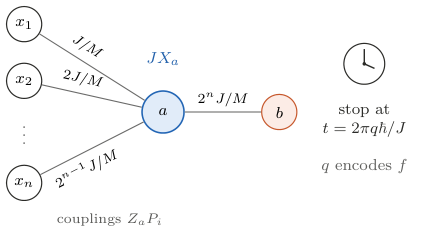

# Boolean Oracles by Waiting

Javier Blanco-Romero

Department of Telematic Engineering, Universidad Carlos III de Madrid, Leganés, Madrid, Spain

Work in progress. Results and proofs remain under review.

Abstract {#abstract .unnumbered}
--------

Can a single fixed Hamiltonian compute every Boolean function if the only thing we choose is when to stop it? It can. We build such a device from the input qubits, one output qubit, and one auxiliary spin coupled to each of them with a strength that is a power of two times a common scale. The auxiliary precesses in a field set by the logical state, and since a precession frequency is the length of a field vector, a square root, the frequencies of different logical states are rationally independent. Waiting then sweeps their phases over a torus and eventually reaches any pattern of signs. Without the auxiliary, a parity constraint forbids this unless some interaction involves every input. The price of this frugal interface is set by information. A stopping time resolved within a budget of action carries about the logarithm of that budget in bits, while a truth table holds exponentially many bits. For any fixed Hamiltonian, almost every Boolean function therefore needs doubly exponential action, even with heralded retries of arbitrarily rare success, whereas a sequence of two-body controls needs only single exponential action.

Introduction {#sec:intro}
------------

A Hamiltonian computer is a very simple machine. Prepare an input, let it evolve, read the answer \[[1](#ref-Feynman1986)\]. Usually the program lives in the Hamiltonian, or in a sequence of controls applied to it. Here we play a minimalist game. Freeze the couplings once and for all, freeze the preparation and the readout, and keep a single knob, the moment at which we stop the clock. Can waiting alone select every computation? And if it can, what does it cost?

The computations we have in mind are Boolean oracles. For a Boolean function $f:\{0,1\}^n\to\{0,1\}$, the oracle acts as

``{=html} $$U_f\lvert x\rangle_{\mathrm{in}}\lvert \beta\rangle_b
 =\lvert x\rangle_{\mathrm{in}}\lvert \beta\oplus f(x)\rangle_b,
 
\tag{1}$$

where $x$ is the input string, $\beta$ the value of the output qubit $b$, and $\oplus$ addition modulo two. It flips the output exactly when $f(x)=1$, so a device that produces every oracle evaluates every Boolean function. If the Hamiltonian may depend on $f$ the problem is trivial, since $U_f^2=\mathbf{1}$ and $H_f=(\pi\hbar/2T)(\mathbf{1}-U_f)$ implements the oracle in any time $T>0$ \[[2](#ref-Hadfield2021)\], with all the difficulty written into couplings that span the whole register. We ask instead for one Hamiltonian, the same for every $f$, with the function encoded in time alone.

The mechanism is recurrence. Clock hands turning at rationally independent rates never return together to their starting positions, but given time they pass arbitrarily close to any configuration we prescribe. This is Kronecker\'s theorem \[[3](#ref-Weyl1916)\], already used for universal quantum state transfer \[[4](#ref-Cameron2014)\]. If each logical basis state carries its own clock hand, waiting can bring all hands to the phases a chosen oracle requires. Other programmable schemes select the computation through an encoded program state \[[5](#ref-Bohdanowicz2017)\], controlled ancillas \[[6](#ref-Proctor2013), [7](#ref-Proctor2014)\], added local controls \[[8](#ref-Junge2026)\] or a circuit-dependent impurity \[[9](#ref-Pham2026)\]; here nothing is added.

The register cannot do it alone, because few-qubit interactions tie the phases of different basis states together and some oracles violate the tie. One auxiliary spin breaks it, since a precession frequency is the length of a field vector and square roots obey no rational relations. Waiting is then universal, and its price is measured by the action, the spectral width of the Hamiltonian times the evolution time in units of $\hbar$. A stopping time chosen within action $R$ takes only about $R$ distinguishable values and carries about $\log R$ bits, while a truth table on $n$ inputs carries $2^n$. For any fixed Hamiltonian, all but a vanishing fraction of Boolean functions therefore need an expected action

$$C>\delta\bigl(2^{2^{n-1}}-1\bigr),$$

where $\delta$ is the required bias of the output bit. The count follows Shannon\'s counting of circuits \[[10](#ref-Shannon1949)\] and later counts of reachable quantum evolutions \[[11](#ref-Poulin2011), [12](#ref-Caro2022)\], and we make it survive heralding, in which failed runs are repeated and success may be arbitrarily rare \[[13](#ref-Combes2015)\]. With many real control parameters the count is far less restrictive, and standard two-body synthesis reaches every oracle with single exponential action \[[14](#ref-Barenco1995), [15](#ref-Nie2026)\].

Section [2](#sec:task) recasts an oracle as a pattern of phases, Sec. [3](#sec:aux) shows why the register alone cannot produce every pattern, and Sec. [4](#sec:existence) builds the device with one auxiliary spin. Section [5](#sec:density) estimates how long one must wait, Sec. [6](#sec:capacity) proves the counting bound, and Sec. [7](#sec:precision) discusses where the program is stored and how precisely it must be read.

What an oracle asks for {#sec:task}
-----------------------

### Registers and conventions

The device has $n$ input qubits labeled $i=1,\ldots,n$, one output qubit $b$, and one auxiliary qubit $a$. The inputs and the output form the logical register of $m=n+1$ qubits, and the full Hilbert space is

$$\mathcal H=\mathcal H_{\mathrm{in}}\otimes\mathcal H_b\otimes\mathcal H_a,
 \qquad \dim\mathcal H=2^{n+2},
\tag{2}$$

with $\mathcal H_{\mathrm{in}}=(\mathbb C^2)^{\otimes n}$ and $\mathcal H_b=\mathcal H_a=\mathbb C^2$.

We write operators without hats. $X,Y,Z$ are the Pauli operators, a subscript names the qubit they act on, and identity factors elsewhere are implicit; an identity with a subscript, such as $\mathbf{1}_a$, acts on the named register. The computational states $\lvert 0\rangle,\lvert 1\rangle$ are the eigenstates of $Z$, and $\lvert \pm\rangle=(\lvert 0\rangle\pm\lvert 1\rangle)/\sqrt2$ are the eigenstates of $X$. The norm $\lVert \cdot\rVert$ is the operator norm for operators and the Euclidean norm for vectors. A Pauli string is a tensor product of Pauli operators and identities, and its weight is the number of nonidentity factors. A Hamiltonian is $k$-local if it is a sum of terms of weight at most $k$. This bounds the interaction order, not the spatial range.

The resource we count is action. For a Hermitian $H$ with largest and smallest eigenvalues $\lambda_{\max}$ and $\lambda_{\min}$, the spectral width is

$$W(H)=\lambda_{\max}(H)-\lambda_{\min}(H),
\tag{3}$$

and evolution for a time $t\ge0$ has dimensionless action $tW(H)/\hbar$. The action is the largest relative phase the evolution can build up between two energy eigenstates, so it counts the turns of the device\'s internal clock. Width, rather than the largest eigenvalue, is the natural energy scale because adding a multiple of the identity to $H$ changes only a global phase.

### The oracle is a pattern of signs

The output qubit looks complicated in Eq. [(1)](#eq:oracle), because the oracle flips it. In the $X$ basis it becomes simple. Flipping the output does nothing to $\lvert +\rangle_b$ and multiplies $\lvert -\rangle_b$ by $-1$, so

$$\begin{aligned}
 U_f\lvert x\rangle_{\mathrm{in}}\lvert +\rangle_b&=\lvert x\rangle_{\mathrm{in}}\lvert +\rangle_b,\\
 U_f\lvert x\rangle_{\mathrm{in}}\lvert -\rangle_b&=(-1)^{f(x)}\lvert x\rangle_{\mathrm{in}}\lvert -\rangle_b ,
\end{aligned}$$

the phase kickback familiar from query algorithms. It is convenient to label the basis $\lvert x\rangle_{\mathrm{in}}\lvert \chi_y\rangle_b$ by $m$ bits $z=(x,y)\in\{0,1\}^m$, with $\lvert \chi_0\rangle=\lvert +\rangle$ and $\lvert \chi_1\rangle=\lvert -\rangle$. In this basis the oracle is diagonal,

``{=html} $$U_f\lvert z\rangle=(-1)^{g(z)}\lvert z\rangle,\qquad g(x,y)=y\,f(x).
 
\tag{4}$$

Implementing an oracle therefore means producing the right pattern of $2^m$ signs, and the phase function $g$ is just the truth table of $f$ placed on the $y=1$ half of the basis.

Now suppose a fixed Hamiltonian is diagonal in the same basis, with energies $E_z$. After a time $t$, basis state $z$ has acquired the phase $e^{-iE_zt/\hbar}$. Up to a global phase, we need $E_zt/\hbar$ to be close to $\pi g(z)$ modulo $2\pi$ for every $z$ at once. Each basis state is a clock hand turning at angular velocity $E_z/\hbar$, and waiting is the search for a moment at which all hands point to the prescribed positions. Kronecker\'s theorem says such moments exist when the velocities are rationally independent. The design problem is to obtain $2^m$ independent clock rates from couplings that involve only a few qubits each.

Why the register alone is not enough {#sec:aux}
------------------------------------

The first idea is to make the logical register its own clock, with a diagonal Hamiltonian such as $\sum_ic_iZ_i+\sum_{i<j}c_{ij}Z_iZ_j$. Its energies are polynomials of degree two in the signs $(-1)^{z_i}$, and such polynomials are far from generic. Their alternating sum over the cube $\sum_z(-1)^{|z|}E_z$, which picks out the coefficient of the product of all signs, vanishes. This single linear relation among the clock rates already rules out some sign patterns. The point holds for every Hamiltonian on the register, diagonal or not.

**Proposition 1 (Locality threshold).** ``{=html} Let $n\ge2$. A fixed $k$-local Hamiltonian on the $n+1$ logical qubits, with no auxiliary, can approximate every oracle up to a global phase by varying its evolution time if and only if $k\ge n$. In particular, for $n\ge3$ two-body interactions need at least one auxiliary qubit, and Sec. [4](#sec:existence) shows that one suffices.

*Proof.* *Eigenvectors are forced.* An evolution generated by $H$ commutes with $H$, and so does any limit of such evolutions. If waiting approaches $U_f$ up to a phase, then $U_f$ commutes with $H$. Apply this to the point function that equals one at a single input string $x$. Its oracle is a reflection,

$$U_f=\mathbf{1}-2\lvert x,-\rangle\langle x,-\rvert,\qquad
 \lvert x,-\rangle=\lvert x\rangle_{\mathrm{in}}\lvert -\rangle_b,
\tag{5}$$

and commuting with it makes $\lvert x,-\rangle$ an eigenvector of $H$, with eigenvalue $h_x=\langle x,-\rvert H\lvert x,-\rangle$. If every oracle is reachable, this holds for all $2^n$ strings.

*Locality ties the eigenvalues together.* Expand $H$ in Pauli strings. An input factor $X_i$ or $Y_i$ has zero expectation in $\lvert x\rangle$, while $Z_i$ contributes the sign $(-1)^{x_i}$. A $k$-local $H$ therefore makes $h_x$ a polynomial of degree at most $k$ in the signs. For $k<n$ the coefficient of the product of all $n$ signs vanishes,

$$\sum_{x\in\{0,1\}^n}(-1)^{|x|}h_x=0,
\tag{6}$$

where $|x|=\sum_i x_i$ is the Hamming weight. Exponentiating, the phases obey a conservation law,

``{=html} $$\prod_{x\in\{0,1\}^n}\bigl(e^{-ith_x/\hbar}\bigr)^{(-1)^{|x|}}=1
 
\tag{7}$$

at every time. The identity survives limits, and a global phase cancels from it because $\sum_x(-1)^{|x|}=0$. A point oracle puts exactly one minus sign on these eigenvectors, so its alternating product is $-1$, and no $k$-local Hamiltonian with $k<n$ reaches it.

*Order $n$ suffices.* An $n$-local Hamiltonian can give the output-minus sector rationally independent energies while making the output-plus sector return to the identity at a common sequence of times. Kronecker\'s theorem then sets the minus-sector signs independently. Appendix [A](#app:no-auxiliary) gives the construction.

The obstruction is a parity of phases. To escape it with two-body couplings, the clock rates must depend on the logical bits in a way that no low-degree polynomial can mimic. That requires a nonlinear element.

One auxiliary spin {#sec:existence}
------------------

### Why a precessing spin

A spin in a magnetic field is the most economical nonlinear element at hand. The field can depend linearly on whatever sets it, but the spin precesses at an angular frequency proportional to the length of the field vector, and length is a square root. If a two-body coupling makes the field on an auxiliary spin depend on the logical state, each logical state gets its own precession frequency, and these frequencies are square roots of different numbers. Square roots of integers with distinct squarefree parts are linearly independent over the rationals \[[16](#ref-Besicovitch1940)\]. This is exactly the independence Kronecker\'s theorem needs.

To build this, encode each logical qubit by a projector onto its "one" state,

$$P_i=\tfrac12(\mathbf{1}-Z_i)\quad (i=1,\ldots,n),\qquad
 P_m=\tfrac12(\mathbf{1}-X_b).
\tag{8}$$

For an input, $P_i$ projects onto $\lvert 1\rangle_i$. For the output, $P_m$ projects onto $\lvert -\rangle_b$, which is why the output enters in the $X$ basis; the index $i=m$ in a sum over projectors refers to the output. With the integer $M=4^m$ and an energy scale $J>0$, the Hamiltonian is

``{=html} $$H_n=J\Bigl(X_a+\frac{Z_a}{M}\sum_{i=1}^{m}2^{i-1}P_i\Bigr).
 
\tag{9}$$

The auxiliary feels a fixed transverse field $JX_a$ and couples to logical qubit $i$ through $Z_aP_i$ with strength $2^{i-1}J/M$, a star of two-body interactions (Fig. [1](#fig:device)).

Each choice in Eq. [(9)](#eq:hamiltonian) has a reason. In the basis state $z$ the projectors take the values $z_i\in\{0,1\}$, so the weighted sum is the integer $s_z=\sum_i2^{i-1}z_i$, the binary number formed by the bits of $z$. The powers of two make sure that different basis states give different fields. The auxiliary then sees the static field $J(X+s_zZ/M)$ and precesses at angular frequency $2Jr_z/\hbar$, with

$$r_z=\sqrt{1+(s_z/M)^2}=\frac{\sqrt{M^2+s_z^2}}{M}.$$

The large denominator $M=4^m$ does two jobs. It keeps every $M^2+s_z^2$ inside a short interval, which is what forces their squarefree parts to be distinct, as we will see. And it keeps all frequencies within a factor $1+4^{-m}$ of $J$, so the spectral width stays close to $2J$ however large the register grows; any large cost will have to come from time. Finally, the couplings of $H_n/J$ are dyadic rationals, integers divided by powers of two, with $O(n^2)$ binary digits in total. They depend on $n$ but neither on $f$ nor on the accuracy we will ask for, so no truth table can hide in their digits. Rescaling $J$ only rescales all times.

**Figure 1.** The fixed oracle device on $n+2$ qubits. Input node $i$ carries the bit $x_i$, $b$ is the output qubit, and $a$ is the auxiliary. A field $JX_a$ drives the auxiliary, which couples to each logical qubit through $Z_aP_i$ with strength $2^{i-1}J/M$. The couplings never change; the Boolean function is selected by the integer $q$ that fixes the stopping time.

``{=html}

### Universality by waiting

**Theorem 2 (Universality by waiting).** ``{=html} The Hamiltonian $H_n$ has spectral width $2J<W(H_n)<2J(1+4^{-m})$. For every Boolean function $f$ and every tolerance $\eta>0$ there is a positive integer $q$ such that, at $t=2\pi q\hbar/J$,

``{=html} $$\lVert e^{-itH_n/\hbar}-U_f\otimes\mathbf{1}_a\rVert<\eta .
 
\tag{10}$$

The approximation is in operator norm, hence uniform over all initial states, including states entangled with a noninteracting reference, and the auxiliary is returned unchanged to the same accuracy.

*Proof.* *Split into sectors.* The projectors $P_i$ are diagonal in the basis $\lvert z\rangle$ of Sec. [2](#sec:task). With $z$ fixed, only the auxiliary evolves, under the $2\times2$ block

``{=html} $$H_z=J\Bigl(X+\frac{s_z}{M}Z\Bigr),\qquad H_z^2=J^2r_z^2\mathbf{1},
 
\tag{11}$$

with $X,Z$ acting on the auxiliary. The block has eigenvalues $\pm Jr_z$, so $W(H_n)=2J\max_zr_z$, and $s_z<2^m$ gives $1<\max_zr_z<1+4^{-m}$.

*When is a block a pure sign?* Because $H_z^2\propto\mathbf{1}$, the evolution of a block is a rotation of the auxiliary,

$$e^{-itH_z/\hbar}=\cos(Jr_zt/\hbar)\mathbf{1}-i\sin(Jr_zt/\hbar)\frac{H_z}{Jr_z}.$$

Whenever the rotation angle is a multiple of $\pi$, the sine vanishes and the block is $\pm\mathbf{1}$, independently of the rotation axis and of the auxiliary\'s state. This is why the auxiliary comes back unchanged. We sample at $t=2\pi q\hbar/J$ with integer $q$. Then the sector $z=0$, which has $s_0=0$ and $r_0=1$, returns exactly to the identity, matching $g(0)=0$ in Eq. [(4)](#eq:signs). For the other sectors the distance to the target sign is

``{=html} $$\lVert e^{-2\pi iqH_z/J}-(-1)^{g(z)}\mathbf{1}\rVert=2\bigl|\sin(e_z/2)\bigr| ,
 
\tag{12}$$

where $e_z\in(-\pi,\pi]$ is $2\pi qr_z-\pi g(z)$ reduced modulo $2\pi$. We need every $qr_z$ to lie close to $g(z)/2$ modulo one.

*The rates are independent.* The integers $M^2+s_z^2$ are distinct and lie in $[M^2,M^2+M)$, since $s_z^2<4^m=M$. Their squarefree parts, the integers left after removing all square factors, are also distinct. Otherwise two of them would be $du^2<dv^2$ with a common squarefree $d$ and positive integers $u<v$; since $\sqrt d\,u\ge M$, their gap $d(v^2-u^2)\ge2du+d\ge2M+1$ would exceed the length of the interval. By Besicovitch\'s theorem \[[16](#ref-Besicovitch1940)\], $1=r_0$ and the remaining $r_z$ therefore obey no nonzero rational linear relation.

*Align all phases.* Kronecker\'s theorem in its discrete form \[[3](#ref-Weyl1916), [4](#ref-Cameron2014)\] states that when $1,r_1,\ldots,r_k$ are rationally independent, the points $(qr_1,\ldots,qr_k)$ modulo one, for $q=1,2,\ldots$, come arbitrarily close to every point of the unit cube. It supplies integers $q$ for which every $qr_z$ lies as close as we like to $g(z)/2$ modulo one. Taking the maximum of Eq. [(12)](#eq:blockerror) over sectors proves Eq. [(10)](#eq:full), and tensoring with a reference identity does not change the norm.

The auxiliary is a translator. The two-body couplings can only make the field on it linear in the logical bits, and that linear dependence is what the parity constraint of Sec. [3](#sec:aux) cannot escape. The spin turns the field into a frequency through a square root, and the square roots of distinct squarefree integers cannot conspire.

How long must one wait? {#sec:density}
-----------------------

Theorem [2](#thm:existence) guarantees good stopping times but says nothing about when they arrive. A first estimate comes from asking how often they occur.

**Proposition 3 (Frequency of good stopping times).** ``{=html} Fix $f$ and $0<\eta<2$, and let $\varphi=2\arcsin(\eta/2)$. The positive integers $q$ for which Eq. [(10)](#eq:full) holds at $t=2\pi q\hbar/J$ have natural density, the limiting fraction among $1,\ldots,L$ as $L\to\infty$, equal to

``{=html} $$\rho_\eta=\Bigl(\frac{\varphi}{\pi}\Bigr)^{2^{n+1}-1},
 
\tag{13}$$

the same for every Boolean function.

*Proof.* By Eq. [(12)](#eq:blockerror), Eq. [(10)](#eq:full) holds exactly when $|e_z|<\varphi$ in all $2^m-1$ sectors $z\ne0$, that is, when each $qr_z$ lies modulo one within an interval of length $\varphi/\pi$ centered at $g(z)/2$. Since $1$ and the $r_z$ with $z\ne0$ are rationally independent, Weyl\'s theorem \[[3](#ref-Weyl1916)\] makes the fractional parts $(qr_z\bmod1)_{z\ne0}$ uniformly distributed over the $(2^m-1)$-dimensional unit cube. The density of $q$ landing in a box equals the box volume, $(\varphi/\pi)^{2^m-1}$, wherever the box is centered.

Geometrically, the target is a box of side $\varphi/\pi$ in $2^{n+1}-1$ dimensions, and the winding line visits it a fraction of the time equal to its volume. The good integers $q_1<q_2<\cdots$ thus satisfy $q_j/j\to\rho_\eta^{-1}$, so their average spacing grows doubly exponentially with $n$.

Density is a long-run statement, though, and says nothing about the first visit. At $n=2$ and $\eta=0.1$, for instance, the identity oracle is already within $0.03747$ at $q=1$, although $\rho_\eta^{-1}\simeq3.01\times10^{10}$. All oracles share one density but can have very different first good times. To show that most of them must wait long, we need an argument that holds at every time and for every fixed Hamiltonian. Counting supplies it.

The price of a program stored in time {#sec:capacity}
-------------------------------------

### The idea

By the time-energy uncertainty relation, a system whose energies span a width $W$ needs a time of at least order $\hbar/W$ to reach a distinguishable state. Within a total action $R$, a stopping time can therefore be set to only about $R$ mutually distinguishable values. Each value computes at most one function, and there are $2^{2^n}$ functions, so most of them need $R$ doubly exponential in $n$. This section makes the estimate precise for many knobs and many control intervals, and in a form that heralding cannot evade. Heralding is the subtle point. A rarely accepted run has a tiny accepted branch, and after normalization two tiny branches can point in very different directions even when the runs themselves are close. Charging for every rejected attempt removes this loophole.

### Model

We allow more auxiliary qubits than the construction uses. Fix a total of $N\ge n+1$ qubits, split into the input register, the output $b$, a work register $\mathrm w$ of $N_{\mathrm w}$ qubits, and a flag register $\mathrm h$ of $N_{\mathrm h}$ qubits, with $N_{\mathrm w}+N_{\mathrm h}=N-n-1$. Either may be empty. Each run starts in

$$\lvert \psi_x\rangle=\lvert x\rangle_{\mathrm{in}}\lvert 0\rangle_b
              \lvert 0^{N_{\mathrm w}}\rangle_{\mathrm w}
              \lvert 0^{N_{\mathrm h}}\rangle_{\mathrm h},
\tag{14}$$

where $\lvert 0^r\rangle$ denotes $r$ qubits in $\lvert 0\rangle$. At the end a measurement of the flag accepts or rejects the run. A fixed projector $P_{\mathrm h}$ on the flag register defines acceptance, which on the full device reads

$$\Pi=\mathbf{1}_{\mathrm{in}}\otimes\mathbf{1}_b\otimes\mathbf{1}_{\mathrm w}\otimes P_{\mathrm h}.
\tag{15}$$

For example, a single flag qubit can announce success by ending in $\lvert 1\rangle$, and $\Pi=\mathbf{1}$ describes a procedure that always accepts. After acceptance the output is read in the computational basis and the work qubits are discarded. Preparation, register labels, and both measurements are the same for all functions.

Evolution consists of at most $S$ intervals. In interval $j=1,\ldots,S$ a $k$-local Hamiltonian $H_j$ acts for a time $t_j\ge0$, so the evolution and its action are

$$U=e^{-it_SH_S/\hbar}\cdots e^{-it_1H_1/\hbar},\qquad
 A=\sum_{j=1}^{S}t_jW(H_j)/\hbar.
\tag{16}$$

Times and couplings may depend on $f$, but not on the input $x$. The run on input $x$ is accepted with probability $p_x=\lVert \Pi U\lvert \psi_x\rangle\rVert^2>0$. Given acceptance, the state is $\Pi U\lvert \psi_x\rangle/\sqrt{p_x}$, and measuring $b$ must return $f(x)$ with error probability at most $\epsilon<1/2$. We write $\delta=1-2\epsilon>0$ for the required bias of the output. Returning a correct classical bit is weaker than implementing the oracle coherently, so lower bounds in this model also apply to Theorem [2](#thm:existence).

Rejected runs are reset and repeated. Independent retries need $1/p_x$ runs on average, so the worst-case expected action is

$$C=\max_x\frac{A}{p_x}.
\tag{17}$$

Resets and readout are free; charging for them can only raise the cost \[[13](#ref-Combes2015)\]. For a budget $R\ge0$, let $\mathcal F(R)$ be the set of functions admitting an implementation with $C\le R$. Finally, count the knobs. The number of nonidentity Pauli strings of weight at most $k$ on $N$ qubits is

$$K(N,k)=\sum_{r=1}^{\min(k,N)}3^r\binom Nr,
\tag{18}$$

choosing $r$ qubits and one of $X,Y,Z$ on each. A $k$-local generator, up to its identity component, therefore has $K(N,k)$ real coefficients, and $S$ intervals have $d=K(N,k)S$.

### Capacity

**Theorem 4 (Capacity).** ``{=html} For fixed $N,k,S,\epsilon$,

``{=html} $$|\mathcal F(R)|\le\Bigl(1+\frac{2R}{\delta}\Bigr)^{d},\qquad d=K(N,k)\,S .
 
\tag{19}$$

The bound holds even when success probabilities approach zero. If the allowed generator tuples lie in a real linear space of dimension $d'$ modulo scalars, $d$ may be replaced by $d'$.

The proof is a packing argument in the space of controls. Each implementation is a point in a $d$-dimensional space, points that compute different functions must be far apart, and only so many far-apart points fit in a ball of radius set by the budget. The one twist is a change of radial coordinate that handles rare acceptance.

*Proof.* *Controls as points.* Adding a scalar to a Hamiltonian changes only a global phase, so let $[Q]$ denote a Hermitian operator $Q$ modulo multiples of the identity. A run is the point

$$G=([t_jH_j/\hbar])_{j=1}^S
\tag{20}$$

of integrated generators, in a real space of dimension $d$. Each entry is one interval\'s generator multiplied by its duration, so it fixes that interval\'s evolution completely. Equip this space with the norm

$$\lVert G\rVert_*=\sum_{j=1}^S\inf_{c\in\mathbb R}\lVert t_jH_j/\hbar-c\mathbf{1}\rVert=A/2,
\tag{21}$$

where the equality follows by centering each spectrum. The norm of a run is half its action. If $R=0$, or the allowed space is zero dimensional, the evolution is fixed up to a phase and at most one function is possible; assume otherwise. Writing $U_G$ for the evolution of $G$, Duhamel\'s formula expresses the difference of two exponentials as an integral of the difference of their generators, so each interval\'s evolution changes by at most the change in its integrated generator. Summing over the ordered product gives

``{=html} $$\inf_{\theta\in\mathbb R}\lVert U_G-e^{i\theta}U_{G'}\rVert\le\lVert G-G'\rVert_*.
 
\tag{22}$$

Nearby controls give nearby evolutions.

*Different answers force distance.* Take implementations $G,G'$ of two distinct functions, with actions $A,A'$, and an input $x$ on which the functions differ. Their unnormalized accepted states are $u=\Pi U_G\lvert \psi_x\rangle$ and $v=\Pi U_{G'}\lvert \psi_x\rangle$, with acceptance probabilities $p=\lVert u\rVert^2$ and $p'=\lVert v\rVert^2$. The output observable $Z_b$ commutes with $\Pi$, since output and flag are different qubits. Conditional correctness makes $\langle u\rvert Z_b\lvert u\rangle$ and $\langle v\rvert Z_b\lvert v\rangle$ opposite in sign, with magnitudes at least $\delta p$ and $\delta p'$. For every phase $\theta$,

$$\begin{aligned}
 \delta(p+p')&\le\bigl|\langle u\rvert Z_b\lvert u\rangle-\langle v\rvert Z_b\lvert v\rangle\bigr|\\
 &\le(\sqrt p+\sqrt{p'})\lVert u-e^{i\theta}v\rVert,
 \end{aligned}
\tag{23}$$

by expanding the difference of quadratic forms and using $\lVert Z_b\rVert=1$. Projection does not increase norms, so Eq. [(22)](#eq:control-distance) also bounds $\lVert u-e^{i\theta}v\rVert$. Here the budget enters, since $C\le R$ gives $p\ge A/R$ and $p'\ge A'/R$. Together with $(\sqrt p+\sqrt{p'})^2\le2(p+p')$, this yields

``{=html} $$\lVert G-G'\rVert_*\ge\delta\sqrt{(A+A')/(2R)}.
 
\tag{24}$$

*Rescale to uniform separation.* The separation [(24)](#eq:run-separation) shrinks for cheap runs, so points near the origin could crowd together. Measure them instead in the radial coordinate $\sqrt A$. Set $V=G/\sqrt A$ (and $V=0$ if $A=0$), so that $\lVert V\rVert_*=\sqrt A/2$. With $\alpha=\sqrt A\ge\alpha'=\sqrt{A'}$, the reverse triangle inequality gives $\alpha-\alpha'\le2\lVert V-V'\rVert_*$, and hence

$$\begin{aligned}
 \lVert G-G'\rVert_*&=\lVert \alpha(V-V')+(\alpha-\alpha')V'\rVert_*\\
 &\le\alpha\lVert V-V'\rVert_*+(\alpha-\alpha')\alpha'/2\\
 &\le(\alpha+\alpha')\lVert V-V'\rVert_*.
 \end{aligned}
\tag{25}$$

Combined with Eq. [(24)](#eq:run-separation) and $\alpha+\alpha'\le\sqrt{2(A+A')}$, this shows that distinct functions have rescaled points at least $\delta/(2\sqrt R)$ apart, whatever their actions. Two distinct functions cannot both have zero action, and $p_x\le1$ gives $A\le R$, so every rescaled point lies within $\lVert V\rVert_*\le\sqrt R/2$.

*Count.* Place an open ball of radius $\delta/(4\sqrt R)$ around one rescaled point per function. The balls are disjoint and lie inside a ball of radius $\sqrt R/2+\delta/(4\sqrt R)$. Volumes in a $d$-dimensional normed space scale as the $d$th power of the radius, and the ratio gives $(1+2R/\delta)^d$. The same argument runs in dimension $d'$ when the controls lie in a smaller linear space.

Taking logarithms, $\log_2|\mathcal F(R)|\le d\log_2(1+2R/\delta)$. This is the bit count of the introduction made exact, with $d$ real knobs and budget $R$ selecting at most $d\log_2(1+2R/\delta)$ bits\' worth of functions. The $\sqrt A$ rescaling is what lets the count tolerate success probabilities approaching zero, because a rare success has to be paid for with many retries. The retry model resets each failed run before the next attempt.

### Consequences

**Corollary 5 (A fixed Hamiltonian).** ``{=html} If $H$ is fixed and only its nonnegative duration depends on $f$, then, with the same preparation, readout, and retry rules, at most $1+R/\delta$ functions are evaluable with expected action at most $R$, whatever the dimension or locality of $H$. Consequently all but a fraction $2^{-2^{n-1}}$ of Boolean functions require

``{=html} $$C>\delta\bigl(2^{2^{n-1}}-1\bigr) .
 
\tag{26}$$

*Proof.* If $W(H)=0$ the evolution is scalar and at most one function is possible. Otherwise all integrated generators are proportional to one fixed operator, and the rescaled points lie on a single ray at distances $\sqrt A/2\in[0,\sqrt R/2]$ from the origin, at least $\delta/(2\sqrt R)$ apart. There are at most $1+R/\delta$ of them. Setting $R=\delta(2^{2^{n-1}}-1)$ allows at most $2^{2^{n-1}}$ of the $2^{2^n}$ functions.

This applies to our construction. An operator-norm error $\eta$ gives decision error at most $\eta^2$, because the ideal output has no amplitude in the wrong-output subspace, so any fixed $0<\eta<1/\sqrt2$ allows Corollary [5](#cor:fixed) with $\epsilon=\eta^2$ and no heralding. Since $W(H_n)/J$ is bounded above and below, almost every oracle needs a doubly exponential waiting time in units of $\hbar/J$. The statement holds at all nonnegative times, not just the integer times of Proposition [3](#prop:density), and it is the rigorous counterpart of the torus estimate. It does not provide a matching upper bound on the first good time. Adding auxiliary qubits does not help either, since the corollary holds whatever the size of the device.

More knobs do help. Letting the controls change between intervals enlarges the space being packed, and the same count becomes a tradeoff between action and the number of intervals.

**Corollary 6 (Action and control intervals).** ``{=html} Fix $N,k,S$ and $0\le\epsilon<1/2$, with the preparation and readout of Theorem [4](#thm:capacity). All but a fraction $2^{-2^{n-1}}$ of Boolean functions have the following property. Every implementation with at most $S$ intervals has expected action $C$ satisfying

``{=html} $$K(N,k)\,S\,\log_2\Bigl(1+\frac{2C}{\delta}\Bigr)>2^{n-1}.
 
\tag{27}$$

The exceptional set may depend on these fixed parameters. Conversely, controlled two-body evolution implements every oracle exactly, up to a global phase, with $O(n2^n)$ intervals and action, without auxiliary qubits.

*Proof.* For the lower bound, apply Theorem [4](#thm:capacity) with

$$R=\frac{\delta}{2}\Bigl(2^{2^{n-1}/[K(N,k)S]}-1\Bigr).$$

At most $2^{2^{n-1}}$ functions admit $C\le R$, which proves Eq. [(27)](#eq:exchange).

For the upper bound we use the sign picture of Eq. [(4)](#eq:signs) and write the sign pattern as a product of simple rotations. Expand $g$ in Walsh characters $w_B(z)=\prod_{i\in B}(-1)^{z_i}$, the Fourier basis on bit strings, labeled by subsets $B\subseteq\{1,\ldots,m\}$. With Fourier coefficients $\widehat g_B$,

$$\begin{aligned}
 \widehat g_B&=2^{-m}\sum_zg(z)w_B(z),\\
 (-1)^{g(z)}&=\prod_Be^{-i\pi\widehat g_Bw_B(z)}.
 \end{aligned}
\tag{28}$$

After a change of the output to its $X$ basis, let $Z_B=\prod_{i\in B}Z_i$, with index $m$ denoting the output. Each nonempty $B$ contributes a rotation $e^{-i\pi\widehat g_BZ_B}$, implemented by a chain of controlled-NOT gates that computes the parity of $B$ on one qubit, a single-qubit rotation, and the reverse chain \[[14](#ref-Barenco1995)\]. This uses $O(m)$ gates per subset and no scratch qubits; the empty subset is a global phase. Each gate has a Hermitian logarithm of spectral width at most $2\pi$, so it costs at most $2\pi$ action. Summing over the $2^m$ subsets and the output basis changes gives $O(n2^n)$ intervals and action.

For two-body interactions on $N=n+2$ qubits, $K(N,2)=O(n^2)$. With $S=1$, Eq. [(27)](#eq:exchange) gives $C=2^{\Omega(2^n/n^2)}$ for almost every function, even if the constant Hamiltonian is tailored to each function. Read the other way, at a budget $R(n)\le2^{cn}$ with $c>0$ the fraction of functions reachable with $S(n)$ intervals is at most

$$\frac{\bigl(1+2R(n)/\delta\bigr)^{K(N,2)S(n)}}{2^{2^n}},
\tag{29}$$

so reaching even half of all truth tables at single exponential action requires $S(n)=\Omega(2^n/n^3)$ intervals. The elementary controlled construction is within polynomial factors of this count, and sharper oracle synthesis is available \[[15](#ref-Nie2026)\].

Where the program is stored {#sec:precision}
---------------------------

The capacity bound reads like a conservation law. A typical truth table holds $2^n$ bits, and a device can keep them in its couplings, in its sequence of controls, or in its stopping time, at an exchange rate set by $d\log_2(1+2R/\delta)$. The Hamiltonian $H_f$ of the introduction keeps everything in its couplings and runs at constant action, but those couplings involve the whole register. If they must be two-body, Eq. [(27)](#eq:exchange) with $S=1$ shows that constant action requires at least of order $2^{n/2}$ qubits, enough coefficients to hold the table. At single exponential action, a control sequence needs at least of order $2^n/n^3$ intervals. Our star keeps the bits in a single duration and pays with doubly exponential action. For typical functions the bits can be moved from one place to another, but not compressed away. The bound concerns typical truth tables rather than an explicit hard function, and it differs from the no-programming theorem \[[17](#ref-Nielsen1997)\], which varies the program state of a fixed processor, whereas changing the duration changes the processor unitary itself. Energy alone does not bound computational speed \[[18](#ref-Jordan2017)\], and any such bound depends on which resources are counted \[[19](#ref-Russell2017), [20](#ref-Bournez2021)\]; ours counts action, summed over all attempts.

A program stored in time also has to be read accurately. Let $H$ be the ideal Hamiltonian, $E$ a Hermitian error in it, and $\Delta t$ an error in the stopping time. If the ideal evolution approximates $U_f\otimes\mathbf{1}_a$ within $\eta$, Duhamel\'s formula bounds the actual error, up to a global phase, by

``{=html} $$\eta+\frac{t}{\hbar}\inf_{c\in\mathbb R}\lVert E-c\mathbf{1}\rVert+\frac{|\Delta t|}{2\hbar}W(H+E) .
 
\tag{30}$$

This is a sufficient calibration condition against arbitrary perturbations of the stated size. For an additional error allowance $\xi$, it suffices that the centered Hamiltonian error be $O(\hbar\xi/t)$ and the timing error $O(\hbar\xi/W(H+E))$. For the star, specifying each of its $O(n)$ coefficients to operator-norm accuracy of order $\hbar\xi/t$ is sufficient, with $O(\log_2(tJ/\hbar)+\log_2(n/\xi))$ binary digits per coefficient. At doubly exponential durations this is exponentially many digits. The absolute clock resolution can stay constant, while the range of times the clock must represent grows with $t$. The program sits in the digits of the stopping time, and our sufficient condition asks for the couplings to be known to a comparable number of digits. Equidistribution supplies no bound on the first good duration, so it supplies no upper bound on the precision sufficient for that first implementation either.

Conclusion {#sec:discussion}
----------

A fixed two-body Hamiltonian with dyadic couplings and one auxiliary spin approximates every Boolean oracle, selected purely by the stopping time. The auxiliary works because a precession frequency is the length of a field, and square roots break the parity constraint that binds any low-order Hamiltonian on the register alone; for $n\ge3$ two-body locality makes it necessary. The duration, however, is a single real number, and within an action budget $R$ it carries about $\log R$ bits. Almost every truth table therefore costs doubly exponential action on any fixed Hamiltonian, and heralded retries cannot evade this even when success becomes arbitrarily rare. A sequence of two-body controls reaches every oracle with single exponential action. Realizing a computation is easy; selecting it through time alone is what costs.

The star has bounded interaction order but unbounded degree, and it imposes no spatial propagation constraint. The stopping clock is external, failed runs are reset, and the lower bounds concern almost all truth tables at each input size. Natural next steps are quantitative first-arrival bounds for the construction, bounded-degree realizations, expected-action bounds for adaptive protocols, and, with additional structure beyond counting, an obstruction for an explicit, efficiently described family of functions.

Acknowledgments {#acknowledgments .unnumbered}
---------------

This work was supported in part by Universidad Carlos III de Madrid.

##### Data availability. {#data-availability. .unnumbered}

All analytical results are derived in the article. Scripts and outputs for finite numerical checks are included in the accompanying ancillary files.

An oracle device without an auxiliary {#app:no-auxiliary}
-------------------------------------

This construction proves the attainability statement in Proposition [1](#prop:aux). The idea is to let the output-minus sector carry the oracle signs while the output-plus sector returns to the identity whenever those signs are read.

Let $[n]=\{1,\ldots,n\}$, choose real numbers $h_x$, and expand the diagonal input operator in parity products,

$$\sum_xh_x\lvert x\rangle\langle x\rvert=\sum_{B\subseteq[n]}c_BZ_B,
 \qquad Z_B=\prod_{i\in B}Z_i,
\tag{31}$$

with real coefficients $c_B$ and $Z_\varnothing=\mathbf{1}$. With output projectors $\Pi_\pm=(\mathbf{1}_b\pm X_b)/2$, an energy $\lambda>|c_{[n]}|$, and $\kappa=\sqrt{\lambda^2-c_{[n]}^2}$, set

$$\begin{aligned}
 H={}&\sum_{\substack{B\subseteq[n]\\ |B|<n}}c_BZ_B\otimes\Pi_-
       +c_{[n]}Z_{[n]}\otimes\mathbf{1}_b\\
     &+\kappa X_1\otimes\Pi_+ .
 \end{aligned}
\tag{32}$$

Every term has weight at most $n$. On the minus sector $H$ has eigenvalues $h_x$. On the plus sector it reduces to $c_{[n]}Z_{[n]}+\kappa X_1$, two anticommuting terms whose square is $\lambda^2\mathbf{1}$, so at times $t=2\pi q\hbar/\lambda$ with integer $q$ this sector returns exactly to the identity. Choosing $1$ and all $h_x/\lambda$ rationally independent (for instance $h_x=\sqrt{\ell_x}$ for distinct primes $\ell_x$ in fixed energy units, and an integer $\lambda>|c_{[n]}|$), Kronecker\'s theorem drives the minus-sector phases $e^{-2\pi iqh_x/\lambda}$ toward any signs $(-1)^{f(x)}$. The $n$-body parity term $c_{[n]}Z_{[n]}$ is what supplies the phase freedom that lower orders lack, and it is the price of doing without the auxiliary.

AI assistance {#ai-assistance .unnumbered}
-------------

AI tools assisted with writing, mathematical derivations, literature review, and numerical code. Some claims in this working paper remain to be independently checked.

References {#references .unnumbered}
----------

1.  ``{=html} Richard P. Feynman. Quantum mechanical computers. *Foundations of Physics*, 16(6):507--531, 1986.

2.  ``{=html} Stuart Hadfield. On the Representation of Boolean and Real Functions as Hamiltonians for Quantum Computing. *ACM Transactions on Quantum Computing*, 2(4):1--21, 2021. Article 18.

3.  ``{=html} Hermann Weyl. Über die Gleichverteilung von Zahlen mod. Eins. *Mathematische Annalen*, 77(3):313--352, 1916.

4.  ``{=html} Stephen Cameron, Shannon Fehrenbach, Leah Granger, Oliver Hennigh, Sunrose Shrestha, and Christino Tamon. Universal state transfer on graphs. *Linear Algebra and its Applications*, 455:115--142, 2014.

5.  ``{=html} Thomas C. Bohdanowicz and Fernando G. S. L. Brandão. Universal Hamiltonians for Exponentially Long Simulation, 2017.

6.  ``{=html} Timothy J. Proctor, Erika Andersson, and Viv Kendon. Universal quantum computation by the unitary control of ancilla qubits and using a fixed ancilla-register interaction. *Physical Review A*, 88(4):042330, 2013.

7.  ``{=html} Timothy J Proctor and Viv Kendon. Minimal ancilla mediated quantum computation. *EPJ Quantum Technology*, 1(1):13, 2014.

8.  ``{=html} Marius Junge, Jason Pollack, and Luke Visser. Universal computation with magic Hamiltonians, 2026.

9.  ``{=html} N. C. Mai Pham and Raul A. Santos. Time evolution of impurity models and their universality for quantum computation, 2026.

10. ``{=html} Claude E. Shannon. The Synthesis of Two-Terminal Switching Circuits. *Bell System Technical Journal*, 28(1):59--98, 1949.

11. ``{=html} David Poulin, Angie Qarry, Rolando Somma, and Frank Verstraete. Quantum Simulation of Time-Dependent Hamiltonians and the Convenient Illusion of Hilbert Space. *Physical Review Letters*, 106(17):170501, 2011.

12. ``{=html} Matthias C. Caro, Hsin-Yuan Huang, M. Cerezo, Kunal Sharma, Andrew Sornborger, Lukasz Cincio, and Patrick J. Coles. Generalization in quantum machine learning from few training data. *Nature Communications*, 13(1):4919, 2022.

13. ``{=html} Joshua Combes and Christopher Ferrie. Cost of postselection in decision theory. *Physical Review A*, 92(2):022117, 2015.

14. ``{=html} Adriano Barenco, Charles H. Bennett, Richard Cleve, David P. DiVincenzo, Norman Margolus, Peter Shor, Tycho Sleator, John A. Smolin, and Harald Weinfurter. Elementary gates for quantum computation. *Physical Review A*, 52(5):3457--3467, 1995.

15. ``{=html} Junhong Nie and Wei Zi. Nearly optimal quantum circuits for Boolean oracles, 2026.

16. ``{=html} A. S. Besicovitch. On the Linear Independence of Fractional Powers of Integers. *Journal of the London Mathematical Society*, s1-15(1):3--6, 1940.

17. ``{=html} M. A. Nielsen and Isaac L. Chuang. Programmable Quantum Gate Arrays. *Physical Review Letters*, 79(2):321--324, 1997.

18. ``{=html} Stephen P. Jordan. Fast quantum computation at arbitrarily low energy. *Physical Review A*, 95(3):032305, 2017.

19. ``{=html} Benjamin Russell and Susan Stepney. The Geometry of Speed Limiting Resources in Physical Models of Computation. *International Journal of Foundations of Computer Science*, 28(4):321--333, 2017.

20. ``{=html} Olivier Bournez and Amaury Pouly. A Survey on Analog Models of Computation. In Vasco Brattka and Peter Hertling, editors, *Handbook of Computability and Complexity in Analysis*, Theory and Applications of Computability, pages 173--226. Springer, Cham, 2021.
