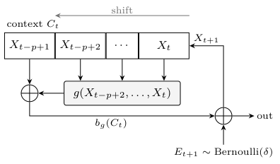
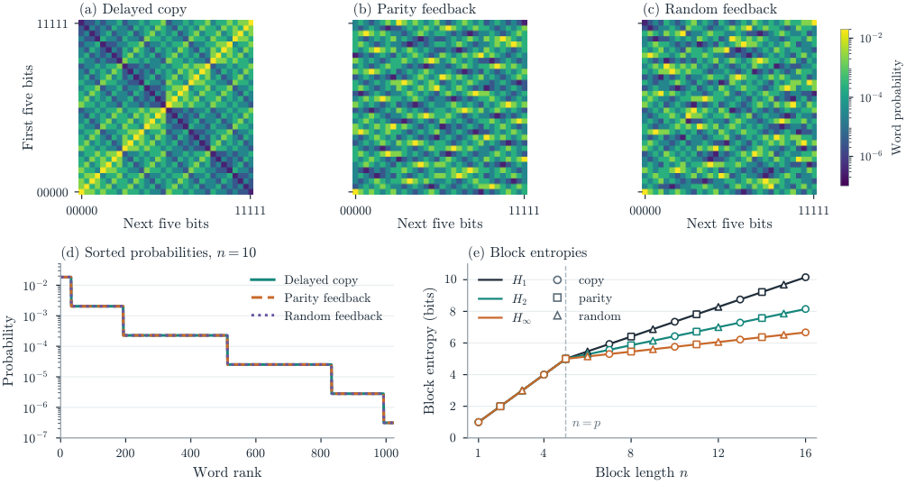
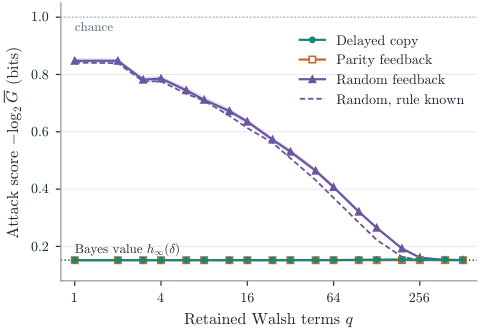
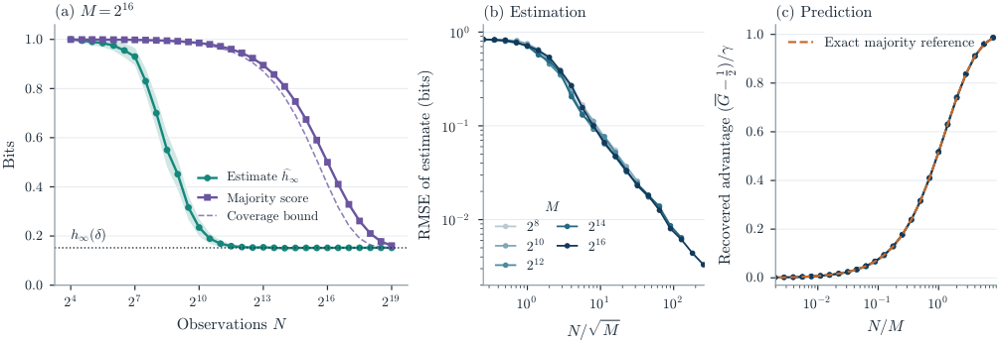

# Identical Entropy Profiles, Different Prediction Costs

Javier Blanco-Romero and Florina Almenares Mendoza

Department of Telematic Engineering, Universidad Carlos III de Madrid, Leganés, Madrid, Spain

Work in progress. Results and proofs remain under review.

Abstract {#abstract .unnumbered}
--------

Min-entropy tells us how often the best guess of the next bit succeeds. It does not tell us how hard that guess is to compute. We make this gap exact with a family of stationary binary sources driven by an invertible feedback register. All members assign the same list of probabilities to the blocks of every length, so they share every Rényi block entropy, their statistical complexity, and their excess entropy. Yet the optimal next-bit decision ranges from reading a single wire to circuits of exponential size, even when only a fixed fraction of the optimal advantage is required. A companion result separates estimation from learning. For an unknown noisy table on independent contexts, the min-entropy can be estimated from a number of samples growing as the square root of the number of contexts, while useful prediction needs a number proportional to it. The family gives predictor-based entropy tests a target of known entropy and tunable cost.

Introduction
------------

Predictors are a standard tool for assessing random number generators. An algorithm that guesses the next bit better than chance exposes a departure from independent fair bits. This logic underlies the predictor estimates of NIST SP 800-90B \[[1](#ref-kelsey2015predictive), [2](#ref-sonmez2018recommendation)\] and their machine-learning extensions \[[3](#ref-blanco2025machine)\]. It runs in one direction only. A successful prediction exposes a regularity, but a failed prediction may reflect the predictor as much as the source. Computational notions of entropy make this explicit by defining unpredictability relative to bounded predictors or distinguishers \[[4](#ref-yao1982theory), [5](#ref-barak2003computational), [6](#ref-hsiao2007conditional)\].

Entropy depends on how probability is distributed over outcomes, not on which outcome carries it. Relabel the faces of a loaded die and every entropy stays the same, while the face worth betting on moves, and if the relabeling is complicated, so is the bet. A noisy binary rule shows the same thing. At each context one output has probability $1-\delta$ and the other $\delta$, for a fixed noise rate $0<\delta<1/2$, so the guessing probability is always $1-\delta$, yet the favored bit may depend on the context through a complicated function. Invertible feedback, borrowed from shift-register theory \[[7](#ref-golomb2014shift), [8](#ref-dabrowski2014searching)\], turns this into a stationary source while preserving the probability spectrum of every block. With memory $p$, every member has the Rényi block entropies

$$H_\alpha(X_1^n)=\min(n,p)+\max(n-p,0)\,h_\alpha(\delta)$$

for every order $\alpha$ and block length $n$, where $h_\alpha(\delta)$ is the entropy of one noisy bit, and the same statistical complexity \[[9](#ref-crutchfield1989inferring), [10](#ref-shalizi2001computational)\] and excess entropy \[[11](#ref-grassberger1986toward), [12](#ref-crutchfield2003regularities), [13](#ref-bialek2001predictability)\]. Their next-bit rules nevertheless range from a wire to circuits of order $2^p/p$ gates, by Shannon\'s counting argument \[[14](#ref-shannon1949synthesis), [15](#ref-jukna2012boolean)\]. Calibrated benchmarks with known optimal prediction error already exist \[[16](#ref-marzen2024benchmarks)\]; here the predictor is handed the full context, and the whole probability spectrum stays fixed while the decision cost varies.

Learning the source adds a second gap. Estimating the best achievable performance can take fewer observations than learning a predictor that attains it, as Kong and Valiant showed \[[17](#ref-kong2018learnability)\], and we give a finite-alphabet instance for conditional min-entropy in which coincidences between contexts reveal the noise level long before prediction is possible.

These questions matter for the certification of physical random number generators, quantum ones included, whose entropy is routinely assessed with predictor-based tests \[[1](#ref-kelsey2015predictive), [2](#ref-sonmez2018recommendation)\]. A source with known entropy and tunable prediction cost lets one check whether such a test measures the source or its own limitations.

Section [2](#sec:family) builds the source family and computes its entropy profile. Section [3](#sec:hardness) bounds the circuit cost of the optimal decision and illustrates it with a learner that keeps a limited number of Fourier terms. Section [4](#sec:estimation) separates estimation from learning, and Sec. [5](#sec:conclusion) discusses what a prediction experiment measures.

Changing the rule without changing the entropy {#sec:family}
----------------------------------------------

### The source

We want a family of sources that look identical to every entropy measure while their optimal predictors differ as much as possible. A feedback shift register is a convenient laboratory. It is a classical model of pseudorandom bit streams, its state is a window of recent bits, and its rule can be as simple or as complicated as we like.

Let $X_t\in\{0,1\}$ be the bit emitted at integer time $t$, write $X_a^b=(X_a,\ldots,X_b)$ for a block, and let $\oplus$ denote addition modulo two. Fix a memory length $p\ge2$, a noise probability $0<\delta<1/2$, and a Boolean feedback function $g:\{0,1\}^{p-1}\to\{0,1\}$. Start from a uniformly random block $X_1^p$, draw noise bits $E_{t+1}$ independently of the past with $\mathbb{P}(E_{t+1}=1)=\delta$, and let

``{=html} $$X_{t+1}=X_{t-p+1}\oplus g(X_{t-p+2},\ldots,X_t)\oplus E_{t+1},
\qquad t\ge p .

\tag{1}$$

Each new bit is the oldest bit in the window, corrected by an arbitrary function of the other $p-1$ bits, and occasionally flipped by noise (Fig. [1](#fig:register)).

The current context is the window $C_t=X_{t-p+1}^t$. For a possible context $c=(c_1,\ldots,c_p)$, define its preferred output $b_g(c)$ and its noiseless successor $T_g(c)$,

``{=html} $$b_g(c)=c_1\oplus g(c_2,\ldots,c_p),\qquad
T_g(c)=(c_2,\ldots,c_p,b_g(c)).

\tag{2}$$

The feature that preserves the entropy profile is that $T_g$ is a permutation of the $2^p$ contexts. A permutation moves probability from one context to another without ever merging two contexts or splitting one, so it rearranges the probabilities without changing their list. The successor keeps the suffix $c_2,\ldots,c_p$, and the discarded bit can be recovered from the new one as $c_1=b_g(c)\oplus g(c_2,\ldots,c_p)$. Because the oldest bit enters linearly, $g$ can be as complicated as we like without spoiling invertibility. This is the nonsingular feedback form of shift-register theory \[[7](#ref-golomb2014shift), [8](#ref-dabrowski2014searching)\].

**Figure 1.** Noisy nonsingular feedback register, Eq. [(1)](#eq:source). The oldest bit enters the output linearly, so the noiseless update $T_g$ is invertible for every feedback function $g$. The preferred output $b_g(C_t)$ is the Bayes decision for the next bit.

``{=html}

### What stays fixed

We compare the sources through three kinds of quantities. Logarithms are base two unless written as $\ln$. A finite random variable $W$ with probabilities $q_w=\mathbb{P}(W=w)$ has Rényi entropy of order $\alpha$,

``{=html} $$H_\alpha(W)=\frac{1}{1-\alpha}\log\sum_w q_w^\alpha,
\qquad 0<\alpha<\infty,\quad\alpha\ne1,

\tag{3}$$

with the limits $\alpha\to1$, $\alpha\to\infty$, and $\alpha\to0$ giving the Shannon entropy $H_1(W)=-\sum_w q_w\log q_w$, the min-entropy $H_\infty(W)=-\log\max_w q_w$, and the logarithm $H_0$ of the support size \[[18](#ref-renyi1961measures)\]. We write $h_\alpha(\delta)$ for the Rényi entropy of a Bernoulli variable with parameter $\delta$. The full list of block probabilities determines every Rényi entropy at that length, so fixing the list fixes all of them at once.

Predictive memory is measured on the two-sided stationary extension of the source. Two pasts are equivalent when they induce the same law of the entire future; the equivalence class is the causal state, and its Shannon entropy $C_\mu$ is the statistical complexity of computational mechanics \[[9](#ref-crutchfield1989inferring), [10](#ref-shalizi2001computational)\]. It counts how much a minimal optimal predictor must remember. The excess entropy $\mathcal E$ is the mutual information $I(\cdot;\cdot)$ between the infinite past and the infinite future \[[11](#ref-grassberger1986toward), [12](#ref-crutchfield2003regularities), [13](#ref-bialek2001predictability)\], the total amount of the future that the past can explain.

Invertibility suggests how the calculation will work. Specify the initial context and then the independent noise bits; these data determine the emitted word uniquely. Changing $g$ changes that word, while its probability remains the product of the same context and noise probabilities. We also need to check that the context law is stationary and that different contexts carry different predictive information.

**Theorem 1 (Common entropy profile).** ``{=html} For every feedback rule $g$, the context chain is irreducible and aperiodic, with the uniform stationary distribution on $\{0,1\}^p$. At block length $n\le p$ every word has probability $2^{-n}$. At length $n\ge p$, the words whose realized noise string has $j$ ones have probability and multiplicity

``{=html} $$2^{-p}\delta^j(1-\delta)^{n-p-j},
\qquad
2^p\binom{n-p}{j},
\qquad j=0,\ldots,n-p.

\tag{4}$$

Consequently, for every order $\alpha\in[0,\infty]$,

``{=html} $$H_\alpha(X_1^n)=\min(n,p)+\max(n-p,0)\,h_\alpha(\delta).

\tag{5}$$

All $2^p$ contexts are distinct causal states, and

``{=html} $$C_\mu=p,\qquad
\mathcal E=I(X_{-\infty}^{0};X_1^\infty)=p[1-h_1(\delta)].

\tag{6}$$

The three steps below establish stationarity, the block spectrum, and the minimal predictive memory.

*Proof.* *Stationarity.* Both next bits have positive probability, so any context reaches any other in $p$ steps, and the all-zero context has a self-loop. A destination context $(u,y)$, with suffix $u\in\{0,1\}^{p-1}$ and appended bit $y$, has exactly two predecessors, $(0,u)$ and $(1,u)$. Their preferred outputs are opposite, so one reaches $(u,y)$ with probability $1-\delta$ and the other with probability $\delta$. The incoming probabilities sum to one, and the uniform law is stationary. Equivalently, the noisy update mixes two permutations, the preferred successor and the successor with its last bit flipped; each preserves the uniform law.

*Words are noise strings.* A word $x_1^n$ with $n\ge p$ determines its initial context and its noise bits through $$e_{t+1}=x_{t+1}\oplus x_{t-p+1}\oplus g(x_{t-p+2},\ldots,x_t),
\qquad p\le t<n,$$ and conversely the initial context and noise bits determine the word. This bijection carries the uniform context law and the independent noise to Eq. [(4)](#eq:spectrum), whatever $g$ is. Only the map from noise strings to words depends on the rule. Summing powers of the probabilities gives Eq. [(5)](#eq:profile), and shorter words are marginals of the uniform context.

*Distinct futures.* From a context $c$, the unique most likely continuation of length $p$ is the noiseless one, $T_g^p(c)$, with probability $(1-\delta)^p$. Since $T_g^p$ is a permutation, distinct contexts have distinct modal futures and hence distinct future laws. The contexts are therefore exactly the causal states, and uniformity gives $C_\mu=p$. Each new bit has conditional Shannon entropy $h_1(\delta)$ given the past, so $I(X_{-\infty}^{0};X_1^n)=H_1(X_1^n)-n h_1(\delta)$, and the limit of Eq. [(5)](#eq:profile) gives Eq. [(6)](#eq:memory).

Changing $g$ changes which words carry the large probabilities and leaves the list of probabilities intact. Figure [2](#fig:profiles) shows this for delayed copy ($g=0$), the parity of three suffix bits, and a random feedback table. Direct enumeration through length 16 agrees with Eq. [(5)](#eq:profile) to within $5.3e-15$ bits. For all 276 rules with $2\le p\le4$, independent checks confirm Eq. [(4)](#eq:spectrum) in exact rational arithmetic, the distinctness of the $2^p$ future laws, and Eq. [(6)](#eq:memory) to within $3\times10^{-14}$ bits.

{width="\\textwidth"}

**Figure 2.** The probabilities move; their spectrum does not. For memory $p=5$ and noise $\delta=0.1$, panels (a)--(c) show the probabilities of ten-bit words under three feedback rules. Rows index the first five bits and columns the next five. (d) Sorting the 1024 probabilities gives coincident curves. (e) Block Rényi entropies: lines are Eq. [(5)](#eq:profile), and open markers are independent enumerations of the three sources, interleaved so that coincident points remain visible.

``{=html}

Two further features matter for entropy estimation. First, the asymptotic min-entropy rate is set by the preferred edges. Weight each edge of the context graph by minus the logarithm of its transition probability. No edge weighs less than $-\log(1-\delta)$, and the preferred edges form the cycles of the permutation $T_g$, all at that weight. The minimum mean cycle weight, which governs min-entropy asymptotics on context graphs \[[19](#ref-blanco2026contextgraphs)\], therefore equals the block min-entropy rate,

``{=html} $$\lim_{n\to\infty}\frac{H_\infty(X_1^n)}{n}=h_\infty(\delta)=-\log(1-\delta).

\tag{7}$$

Second, every window of at most $p$ bits is exactly uniform. A predictor whose only observation is a consecutive suffix of fewer than $p$ bits succeeds with probability exactly $1/2$, even if it knows the rule. The suffix and the next bit form a uniform block of length at most $p$. This behavior of short windows is that of the two-faced processes of Ryabko and Monarev \[[20](#ref-ryabko2005testing)\]; here it coexists with an arbitrary feedback rule.

The cost of the best guess {#sec:hardness}
--------------------------

We now supply the entire context and assume the source law is known. This removes uncertainty about the model and isolates the computation needed to choose the next bit. Let $C$ be a stationary context and $Y$ the bit that follows it. A deterministic predictor $f:\{0,1\}^p\to\{0,1\}$ has success probability $G(f)=\mathbb{P}(f(C)=Y)$. The Bayes rule, which picks the more likely next bit given the context, is $b_g$, and its success $G^\star$ is the operational meaning of the average conditional min-entropy \[[21](#ref-dodis2004fuzzy), [22](#ref-konig2009operational)\],

``{=html} $$\begin{aligned}
G^\star&=\mathbb{E}_C\max_{y\in\{0,1\}}\mathbb{P}(Y=y\mid C)=1-\delta,\\
\widetilde H_\infty(Y\mid C)&=-\log G^\star=h_\infty(\delta).
\end{aligned}

\tag{8}$$

Every context has the same conditional guessing probability, so average and worst-case conditional min-entropies coincide. We call $-\log G(f)$ the predictor\'s attack score. It can never fall below the ideal value [(8)](#eq:guessing), so its gap above the ideal value measures the predictor\'s failure to recover available bias. A high attack score by itself supplies no lower bound on the source\'s min-entropy.

How much computation does the Bayes decision take? We need a measure of computation that does not depend on a particular algorithm or machine. Boolean circuit size is the classical choice. It counts the elementary logical operations needed to compute a function of a fixed number of bits, and it is the measure for which Shannon first showed that most functions are hard \[[14](#ref-shannon1949synthesis)\]. Let $\gamma=G^\star-1/2=1/2-\delta$ be the Bayes advantage over a fair coin. Achieving a fraction $0<\rho\le1$ of it means $G(f)\ge1/2+\rho\gamma$. Fix a finite basis of Boolean gates that can compute every Boolean function, with each gate taking at most two inputs, let $\mathsf{size}(f)$ be the smallest number of gates computing $f$, and define the decision cost

``{=html} $$K_g(\rho)=\min\{\mathsf{size}(f):G(f)\ge1/2+\rho\gamma\}.

\tag{9}$$

The $p$ context bits are supplied as inputs, and lookup tables must be built from gates. For a gate budget $s$, the quantity $-\log\sup_{\mathsf{size}(f)\le s}G(f)$ is an instance of unpredictability entropy \[[6](#ref-hsiao2007conditional)\]; restricted predictors also define usable information \[[23](#ref-xu2020usable)\], with logarithmic loss. Our question is how far $K_g$ can vary across the common profile of Theorem [1](#thm:profile).

At one extreme, $g=0$ makes the decision read the oldest bit, a single wire. Parity feedback needs at most linearly many gates. At the other extreme sits a typical table.

**Theorem 2 (Decision cost at fixed entropy).** ``{=html} Fix $0<\rho\le1$ and draw $g$ uniformly from all Boolean functions on $p-1$ bits; $\mathbb{P}_g$ denotes probability over this choice. There is a constant $a\ge1$, depending only on the gate basis, such that for every integer gate budget $s\ge p$,

``{=html} $$\mathbb{P}_g[K_g(\rho)\le s]
\le\exp\!\left(a s\ln s-\rho^2 2^{p-2}\right).

\tag{10}$$

For each fixed $0<\rho\le1$, a random rule therefore has

``{=html} $$K_g(\rho)=\Theta(2^p/p)

\tag{11}$$

with probability tending to one as $p\to\infty$. The upper bound holds for every rule; the lower bound fails with probability at most $\exp(-c_\rho2^p)$ for a constant $c_\rho>0$ depending only on $\rho$.

The proof counts circuits that recover a prescribed amount of bias. For any fixed circuit, the entries of a random feedback table make its agreements fluctuate independently across suffixes. Concentration bounds the chance of unusually good agreement; counting circuits then bounds the chance that any small circuit performs well.

*Proof.* *Agreement of one circuit.* Let $m=2^{p-1}$ be the number of suffixes, and let $A_g(f)$ be the fraction of contexts, under the uniform law, on which a circuit $f$ agrees with the Bayes rule. Grouping the two contexts that share each suffix $u\in\{0,1\}^{p-1}$, $$\begin{aligned}
A_g(f)&=\frac1m\sum_u V_u,\\
V_u&=\tfrac12\bigl[\mathbf{1}\{f(0,u)=g(u)\}+\mathbf{1}\{f(1,u)=1\oplus g(u)\}\bigr],
\end{aligned}$$ where $\mathbf{1}\{\cdot\}$ is the indicator of an event. Over random $g$ the pair agreements $V_u$ are independent, lie in $[0,1]$, and have mean $1/2$, so Hoeffding\'s inequality \[[24](#ref-hoeffding1963inequalities)\] gives $$\mathbb{P}_g\!\left[A_g(f)\ge\tfrac12+\tfrac\rho2\right]\le\exp(-m\rho^2/2).$$ Fresh noise converts agreement into success,

``{=html} $$G(f)=\delta+(1-2\delta)A_g(f)
=\tfrac12+2\gamma\!\left[A_g(f)-\tfrac12\right],

\tag{12}$$

so reaching $G(f)\ge1/2+\rho\gamma$ requires $A_g(f)\ge1/2+\rho/2$.

*Count circuits.* A circuit with at most $s$ gates on $p\le s$ inputs is specified by each gate\'s type and its two incoming wires, so there are at most $\exp(a s\ln s)$ of them \[[14](#ref-shannon1949synthesis), [15](#ref-jukna2012boolean)\]. Enlarging $a$ only weakens the bound, so we may take $a\ge1$. A union bound over circuits proves Eq. [(10)](#eq:counting-bound).

*Lower bound.* Choose $d_\rho=\rho^2/(8a\ln2)$ and $s=\lfloor d_\rho2^p/p\rfloor$. For large $p$, $s\ge p$ and $\ln s<p\ln2$, so the exponent in Eq. [(10)](#eq:counting-bound) is at most $-\rho^22^p/8$, and $c_\rho=\rho^2/8$ works.

*Upper bound.* Lupanov\'s construction computes any Boolean function of $p-1$ variables with $O(2^p/p)$ gates \[[15](#ref-jukna2012boolean)\], and changing between complete bases costs a constant factor. Computing $g$ and adding the oldest bit gives $b_g$ within the same bound.

For $\rho<1$ the lower bound tolerates errors on a positive fraction of contexts, so approximate prediction is as hard as exact prediction up to constants. In the units of an entropy test, an attack score within $\varepsilon$ bits of the ideal value demands the advantage fraction $$\rho_\varepsilon=\frac{(1-\delta)2^{-\varepsilon}-1/2}{1/2-\delta}>0,
\qquad 0\le\varepsilon<1-h_\infty(\delta).$$ The hard rule is a typical random table, and it stays hard even when the table is known. The cost lies in representing the known decision rule by gates. Typical random tables already require long descriptions; the result makes no computational hardness assumption.

{width="\\columnwidth"}

**Figure 3.** The same entropy profile admits different prediction costs. The horizontal axis is the number $q$ of retained Walsh terms; the vertical axis is the attack score $-\log\overline G$, where $\overline G$ is the mean population success over 30 trials. Bands (narrower than the markers for most points) transform pointwise 95% Monte Carlo intervals for that mean. Copy and parity coincide at the Bayes value. The dashed curve truncates the exact spectrum of the same random rules. Memory $p=10$, noise $\delta=0.1$, and 8192 stationary training transitions.

``{=html}

The common statistical complexity counts the information stored in the predictive state. The circuit cost counts the gates needed to turn that state into a decision. Predictive rate-distortion instead studies how much state information can be discarded at a given loss \[[25](#ref-marzen2016circumventing)\]; here all $p$ context bits are supplied. Grouping contexts by their immediate optimal decision, as in decisional states \[[26](#ref-brodu2011decisional)\], leaves just the balanced bit $b_g(C)$. Maintaining an exact predictor through subsequent updates still requires all $2^p$ causal states, because their future laws differ.

Equation [(9)](#eq:cost) fixes the natural context encoding so that the work of computing the decision cannot be hidden in a relabeling of the input. The description length of $g$ also varies across the family, and minimum description length \[[27](#ref-rissanen1978modeling)\] or Kolmogorov complexity \[[28](#ref-li2008introduction)\] would register that variation. The quantities held fixed here describe the process probabilities and its predictive memory.

The theorem concerns minimal circuits, which are hard to find. A concrete learner shows a similar effect at finite size. After the oldest bit is removed, learning the source means learning $g$ from noisy samples, and the natural coordinates for a Boolean function are its Walsh coefficients, the Fourier expansion on bit strings. Simple rules concentrate on a few coefficients, while a random table spreads its weight over all of them. A learner that keeps only the largest few coefficients is a reasonable proxy for a predictor of limited size. We take $p=10$, $\delta=0.1$, and 8192 consecutive stationary training transitions. Subtracting the oldest context bit from each label modulo two leaves a noisy observation of $g$ on the nine-bit suffix. Expand the sign $(-1)^{g(u)}$ in Walsh functions \[[29](#ref-odonnell2014analysis)\], estimate the coefficients from the training data, and keep the $q$ largest in absolute value, where the integer $q$ is the term budget. The sign of the truncated sum estimates $g(u)$ (a nonnegative sum gives zero), and adding back the oldest bit gives the prediction. Selection and orientation use training data alone. The budget counts retained terms in the Walsh representation, and fitting uses the entire suffix domain.

Figure [3](#fig:capacity) reports 30 trials per rule family, with success integrated exactly over the stationary context law and fresh noise. Copy and parity are single Walsh terms and reach success $0.9$ with one term. Random feedback reaches only 0.5556 at that budget, and its reconstruction with the full budget is majority voting on each suffix. An independent trajectory of 32768 contexts per trial, with label noise averaged analytically, reproduces the population calculation with root mean square discrepancy 0.0009. Truncating the exact spectrum of each random rule gives nearly the same curve. At $q=64$, mean success is 0.754 when learned and 0.774 when the rule is known. Finite data are thus not the main source of error. The gap from the Bayes value persists with exact coefficients, because a random rule spreads its weight over many Walsh terms. The numerical comparison therefore illustrates the cost within a specific representation; Theorem [2](#thm:hardness) gives the separate lower bound over all circuits.

Estimating the value before learning the rule {#sec:estimation}
---------------------------------------------

{width="\\textwidth"}

**Figure 4.** Estimating a value before learning its maximizing action, for $\delta=0.1$. (a) Entropy estimate $\widehat h_\infty$ and majority attack score $-\log\overline G$ for $M=2^{16}$ contexts. The dotted line is the true min-entropy; the dashed curve is minus the logarithm of the coverage bound, Eq. [(17)](#eq:coverage), which bounds success averaged over the uniform table prior for every learner. Bands are pointwise 95% Monte Carlo intervals for means over 200 trials, not intervals for individual estimates. (b) Root mean square error of $\widehat h_\infty$ against $N/\sqrt M$, restricted to $N\le M$. (c) Recovered advantage $(\overline G-1/2)/\gamma$ against $N/M$, with the exact majority reference, Eq. [(18)](#eq:majority), for the largest $M$.

``{=html}

The circuit bound assumes the source law is known. When it must be learned from data, a different separation appears, because the value of the best guess can be learned before the guess itself \[[17](#ref-kong2018learnability)\]. An independent-context model makes this explicit for min-entropy.

### Model and estimator

Let $M\ge2$ be the number of contexts, $[M]=\{1,\ldots,M\}$, and $b:[M]\to\{0,1\}$ an unknown table. A sample of size $N$ is $\mathcal D_N=((C_i,Y_i))_{i=1}^N$, with

``{=html} $$\begin{gathered}
C_i\overset{\mathrm{iid}}{\sim}\mathrm{Uniform}([M]),\qquad
E_i\overset{\mathrm{iid}}{\sim}\mathrm{Bernoulli}(\delta),\\
Y_i=b(C_i)\oplus E_i,
\end{gathered}

\tag{13}$$

where iid means independent and identically distributed, the noise is independent of the contexts, and $0<\delta<1/2$. The estimator knows $M$ and the form of the model but neither $b$ nor $\delta$, and its target is again $h_\infty(\delta)$. Independence of these contexts lets us isolate the role of repeated observations; the stationary source of Eq. [(1)](#eq:source) has dependent contexts.

How can one learn $\delta$ without learning $b$? Encode labels as signs, $Z_i=(-1)^{Y_i}$. For two observations of the same context the unknown table bit cancels in the product, $Z_iZ_j=(-1)^{E_i\oplus E_j}$, leaving pure noise with mean $\theta=(1-2\delta)^2$, the squared conditional bias. Every coincidence is thus a measurement of the noise level, regardless of the table. Averaging over all pairs, for $N\ge2$,

``{=html} $$U_N=\frac{M}{\binom N2}\sum_{1\le i<j\le N}\mathbf{1}\{C_i=C_j\}Z_iZ_j

\tag{14}$$

is an unbiased estimator of $\theta$, a second-order U-statistic, that is, an average of a symmetric function over all pairs of observations \[[30](#ref-hoeffding1948statistics)\]; the factor $M$ compensates the collision probability $1/M$. Coincidences are likewise the basis of sparse uniformity tests and collision-entropy estimators \[[31](#ref-paninski2008coincidence), [32](#ref-skorski2023renyi)\]. Since $G^\star=(1+\sqrt\theta)/2$, clipping the moment to $\widehat\theta=\min(1,\max(0,U_N))$ gives the entropy estimate

``{=html} $$\widehat h_\infty=\psi(\widehat\theta),
\qquad
\psi(u)=-\log\frac{1+\sqrt u}{2},\quad 0\le u\le1,

\tag{15}$$

which need not be unbiased even though $U_N$ is.

A sample of size $N$ contains an expected $N(N-1)/(2M)$ coincident pairs. Their number becomes of order one at the birthday scale $N\sim\sqrt M$; a sufficiently large constant multiple gives fixed precision and confidence. These pairs can estimate the common noise level even while almost every table entry remains unseen. Recovering a fixed fraction of the available prediction advantage requires learning a fixed fraction of the table, which takes $N\sim M$.

### Two sample scales

**Proposition 1 (Two sample scales).** ``{=html} For every fixed table $b$ and $N\ge2$,

``{=html} $$\mathbb{E}U_N=\theta,\quad
\operatorname{Var}(U_N)=
\frac{2(M-\theta^2)+4(N-2)(\theta-\theta^2)}{N(N-1)}.

\tag{16}$$

Fix noise bounds $0<\delta_-<\delta_+<1/2$, an entropy tolerance $0<\varepsilon<[h_\infty(\delta_+)-h_\infty(\delta_-)]/2$, and a confidence $1/2<\eta<1$. The sample size needed to estimate $h_\infty(\delta)$ within $\varepsilon$ with probability at least $\eta$, uniformly over all tables and $\delta\in[\delta_-,\delta_+]$, is $\Theta(\sqrt M)$ as $M\to\infty$.

For prediction, draw $b$ uniformly once and let $A$ be any learner chosen independently of it. On a fresh test pair $(C,Y)$, independent of the training data given $b$, its average success satisfies

``{=html} $$\mathbb{E}_b\mathbb{P}[A(\mathcal D_N,C)=Y\mid b]
\le\frac12+\gamma\left[1-\left(1-\frac1M\right)^{\!N}\right],

\tag{17}$$

with $\gamma=1/2-\delta$, where the probability averages over training data, test data, and any randomness of $A$. Even if $\delta$ is given, average success $1/2+\rho\gamma$ for fixed $\delta$ and $0<\rho<1$ requires $\Theta(M)$ samples, attained by majority voting.

*Proof.* *Variance.* For distinct indices put $W_{ij}=M\mathbf{1}\{C_i=C_j\}Z_iZ_j$. Then $$\mathbb{E}W_{12}=\theta,\qquad
\mathbb{E}W_{12}^2=M,\qquad
\mathbb{E}[W_{12}W_{13}]=\theta,$$ the last used only for $N\ge3$, and pairs with disjoint indices are independent. The variance of the pair average has $\binom N2$ diagonal terms and $6\binom N3$ ordered overlapping-pair terms, which gives Eq. [(16)](#eq:variance). The large diagonal term $2M/N^2$ reflects the birthday effect, since each pair collides only rarely and its rescaled contribution is correspondingly noisy.

*Estimation upper bound.* Since $\theta(1-\theta)\le1/4$, $$\operatorname{Var}(U_N)\le\frac{2M+N-2}{N(N-1)}.$$ On the prescribed noise interval $\theta$ stays away from zero, $\psi$ is Lipschitz near that interval, and clipping cannot increase the error. Chebyshev\'s inequality gives the required precision and confidence with $N=O(\sqrt M)$.

*Estimation lower bound.* Compare the two endpoint noise levels, each averaged over a uniform random table. Until some context repeats, the labels are independent fair bits under either noise level, so the two experiments differ in total variation, the largest difference in the probability they assign to any event, by at most the collision probability, itself at most $\binom N2/M$. An estimate within $\varepsilon$ would distinguish the endpoints with success at least $\eta$, which requires total variation at least $2\eta-1$. Hence $N(N-1)\ge2(2\eta-1)M$.

*Prediction.* An unseen test context carries a fair table bit independent of the data, and even a seen context cannot be predicted beyond $1-\delta$. The test context is unseen with probability $(1-1/M)^N$, which gives Eq. [(17)](#eq:coverage), and for fixed $\rho>0$ this forces $N\ge\ln[1/(1-\rho)]/[-\ln(1-1/M)]=\Omega(M)$. Conversely, let the learner output the majority label at each context, with any fixed tie rule. After $r$ visits its table-bit error is at most $e^{-2r\gamma^2}$ by Hoeffding\'s inequality. The number $R$ of visits to a fresh uniform context is binomial with parameters $N$ and $1/M$, so the average error is at most $$\mathbb{E}e^{-2R\gamma^2}
=\left[1-\frac{1-e^{-2\gamma^2}}{M}\right]^N.$$ A sufficiently large constant multiple of $M$ makes this at most $(1-\rho)/2$, which by Eq. [(12)](#eq:agreement) gives the required success.

The noise interval, precision, and confidence affect only the constants in these sample bounds. The estimator does rely on a common noise rate across contexts. With context-dependent biases the pair statistic estimates the mean squared bias, while guessing depends on the mean absolute bias, and the statistic no longer determines min-entropy.

### Numerical comparison

We use $\delta=0.1$, context counts $M=2^8,2^{10},\ldots,2^{16}$, and 200 independent trials per count, each with a fresh table and fresh data. Within a trial, sample sizes follow a fixed half-octave grid from 16 to $8M$, using nested prefixes, and the collision estimator and the majority learner receive the same observations. Ties and unobserved contexts predict zero, and test success is integrated exactly over the hidden table and fresh noise.

The majority learner has an exact reference curve. Let $B_r$ be binomial with parameters $r$ and $\delta$, the number of flipped labels among $r$ visits to one context. Under the uniform table prior, the majority vote recovers that table bit incorrectly with probability $$e_r=\mathbb{P}(B_r>r/2)+\tfrac12\mathbb{P}(B_r=r/2),$$ where the half weight accounts for ties, including unseen contexts. Averaging over the visit count $R\sim\mathrm{Binomial}(N,1/M)$ gives the mean next-bit success

``{=html} $$G_N^{\rm maj}=1-\delta-(1-2\delta)\mathbb{E}e_R.

\tag{18}$$

Figure [4](#fig:estimation) shows the two scales directly. At $M=65536$ and $N=8192$, the mean entropy estimate is 0.1542 bits, with root mean square error 0.0230 bits around the true value $0.1520$. At the same sample size majority prediction succeeds with probability 0.5378, and even the coverage bound for any learner is only 0.5470, far from the optimum $0.9$. Rescaling the sample axis by $\sqrt M$ for estimation and by $M$ for prediction collapses the curves for different $M$. The residual finite-size correction in estimation comes from the $O(1/N)$ term in Eq. [(16)](#eq:variance).

What a prediction experiment measures {#sec:conclusion}
-------------------------------------

Entropy specifies how often the best guess succeeds; it does not specify the work needed to make it. In the feedback family, the complete block entropy profile and the information in a minimal predictive state stay fixed while the next-bit decision ranges from a wire to $\Theta(2^p/p)$ gates. Invertibility makes this possible, because the feedback rule relabels which continuation is likely without touching how likely it is.

For entropy assessment this gives a controlled experiment. The independent noise fixes the min-entropy rate exactly, and the invertible feedback rule changes the decision cost while preserving the full entropy profile. A predictor that falls short on such a source reveals the limits of its context, representation, or data, and the gap between its score and the known target measures their combined effect. The independent-context result adds the statistical version of the same lesson. The best success probability can be estimated from far fewer observations than are needed to achieve it. That result relies on independent uniform contexts and a common noise rate, and its sample bounds do not transfer automatically to dependent trajectories. The two constructions isolate complementary obstacles, namely computing a known decision rule and learning enough of an unknown rule to act on it.

Data availability {#data-availability .unnumbered}
-----------------

The accompanying code generates the experimental data, figures, and numerical values. From `code/`, run the tests and regenerate the data and figures with

    python3 -m unittest discover -s tests
    python3 -m predictive_complexity.run_paper
    python3 -m predictive_complexity.plot_paper

The data generator records the master seed, package versions, and source hashes in `paper/data/config.json`. Plotted bands are approximate pointwise 95% intervals, using trial means plus or minus 1.96 standard errors and transforming where appropriate. The scripts `validate_profile.py`, `validate_decision_cost.py`, and `validate_estimation.py` in `code/scripts/` check the proof ingredients independently of the package: rational block probabilities for all rules with $2\le p\le4$, binomial agreement tails, enumerated moments and total variation in small sample spaces, and Monte Carlo diagnostics for Eq. [(16)](#eq:variance). These finite checks supplement the proofs; they do not establish the asymptotic bounds.

Acknowledgments {#acknowledgments .unnumbered}
---------------

This work was supported by the Spanish Government under grant PID2023-148716OB-C33, funded by MICIU/AEI/10.13039/501100011033, as part of the DISCOVERY project ("DIstributed Smart Communications with Verifiable EneRgy-optimal Yields"). The Community of Madrid provided further support through the RAMONES-CM project (TEC-2024/COM-504), awarded by Order 5696/2024 of the General Directorate of Research and Technological Innovation.

AI assistance {#ai-assistance .unnumbered}
-------------

AI tools assisted with writing, mathematical derivations, literature review, and numerical code. Some claims in this working paper remain to be independently checked.

References {#references .unnumbered}
----------

1.  ``{=html} John Kelsey, Kerry A. McKay, and Meltem Sönmez Turan. Predictive models for min-entropy estimation. In *Cryptographic Hardware and Embedded Systems -- CHES 2015*, volume 9293 of *Lecture Notes in Computer Science*, pages 373--392, Berlin, 2015. Springer.

2.  ``{=html} Meltem Sönmez Turan, Elaine Barker, John Kelsey, Kerry A. McKay, Mary L. Baish, and Mike Boyle. Recommendation for the entropy sources used for random bit generation. NIST Special Publication 800-90B, National Institute of Standards and Technology, Gaithersburg, MD, 2018.

3.  ``{=html} Javier Blanco-Romero, Vicente Lorenzo, Florina Almenares Mendoza, and Daniel Díaz-Sánchez. Machine learning predictors for min-entropy estimation. *Entropy*, 27(2):156, 2025.

4.  ``{=html} Andrew C. Yao. Theory and application of trapdoor functions. In *23rd Annual Symposium on Foundations of Computer Science (SFCS 1982)*, pages 80--91. IEEE, 1982.

5.  ``{=html} Boaz Barak, Ronen Shaltiel, and Avi Wigderson. Computational analogues of entropy. In *Approximation, Randomization, and Combinatorial Optimization: Algorithms and Techniques (RANDOM-APPROX 2003)*, volume 2764 of *Lecture Notes in Computer Science*, pages 200--215, Berlin, 2003. Springer.

6.  ``{=html} Chun-Yuan Hsiao, Chi-Jen Lu, and Leonid Reyzin. Conditional computational entropy, or toward separating pseudoentropy from compressibility. In *Advances in Cryptology -- EUROCRYPT 2007*, volume 4515 of *Lecture Notes in Computer Science*, pages 169--186, Berlin, 2007. Springer.

7.  ``{=html} Solomon W. Golomb. *Shift Register Sequences*. World Scientific, Singapore, 3rd edition, 2014.

8.  ``{=html} Przemysław Dąbrowski, Grzegorz Łabuzek, Tomasz Rachwalik, and Janusz Szmidt. Searching for nonlinear feedback shift registers with parallel computing. *Information Processing Letters*, 114(5):268--272, 2014.

9.  ``{=html} James P. Crutchfield and Karl Young. Inferring statistical complexity. *Physical Review Letters*, 63(2):105--108, 1989.

10. ``{=html} Cosma Rohilla Shalizi and James P. Crutchfield. Computational mechanics: Pattern and prediction, structure and simplicity. *Journal of Statistical Physics*, 104(3-4):817--879, 2001.

11. ``{=html} Peter Grassberger. Toward a quantitative theory of self-generated complexity. *International Journal of Theoretical Physics*, 25(9):907--938, 1986.

12. ``{=html} James P. Crutchfield and David P. Feldman. Regularities unseen, randomness observed: Levels of entropy convergence. *Chaos*, 13(1):25--54, 2003.

13. ``{=html} William Bialek, Ilya Nemenman, and Naftali Tishby. Predictability, complexity, and learning. *Neural Computation*, 13(11):2409--2463, 2001.

14. ``{=html} Claude E. Shannon. The synthesis of two-terminal switching circuits. *Bell System Technical Journal*, 28(1):59--98, 1949.

15. ``{=html} Stasys Jukna. *Boolean Function Complexity: Advances and Frontiers*, volume 27 of *Algorithms and Combinatorics*. Springer, Berlin, 2012.

16. ``{=html} Sarah E. Marzen, Paul M. Riechers, and James P. Crutchfield. Complexity-calibrated benchmarks for machine learning reveal when prediction algorithms succeed and mislead. *Scientific Reports*, 14(1):8727, 2024.

17. ``{=html} Weihao Kong and Gregory Valiant. Estimating learnability in the sublinear data regime. In *Advances in Neural Information Processing Systems 31 (NeurIPS 2018)*, 2018.

18. ``{=html} Alfréd Rényi. On measures of entropy and information. In *Proceedings of the Fourth Berkeley Symposium on Mathematical Statistics and Probability*, volume 1, pages 547--561, Berkeley, 1961. University of California Press.

19. ``{=html} Javier Blanco-Romero. On the min-entropy asymptotics of binary context graphs. Manuscript in preparation, 2026.

20. ``{=html} B. Ya. Ryabko and V. A. Monarev. Using information theory approach to randomness testing. *Journal of Statistical Planning and Inference*, 133(1):95--110, 2005.

21. ``{=html} Yevgeniy Dodis, Leonid Reyzin, and Adam Smith. Fuzzy extractors: How to generate strong keys from biometrics and other noisy data. In *Advances in Cryptology -- EUROCRYPT 2004*, volume 3027 of *Lecture Notes in Computer Science*, pages 523--540, Berlin, 2004. Springer.

22. ``{=html} Robert König, Renato Renner, and Christian Schaffner. The operational meaning of min- and max-entropy. *IEEE Transactions on Information Theory*, 55(9):4337--4347, 2009.

23. ``{=html} Yilun Xu, Shengjia Zhao, Jiaming Song, Russell Stewart, and Stefano Ermon. A theory of usable information under computational constraints. In *International Conference on Learning Representations (ICLR)*, 2020.

24. ``{=html} Wassily Hoeffding. Probability inequalities for sums of bounded random variables. *Journal of the American Statistical Association*, 58(301):13--30, 1963.

25. ``{=html} Sarah E. Marzen and James P. Crutchfield. Predictive rate-distortion for infinite-order Markov processes. *Journal of Statistical Physics*, 163(6):1312--1338, 2016.

26. ``{=html} Nicolas Brodu. Reconstruction of epsilon-machines in predictive frameworks and decisional states. *Advances in Complex Systems*, 14(5):761--794, 2011.

27. ``{=html} Jorma Rissanen. Modeling by shortest data description. *Automatica*, 14(5):465--471, 1978.

28. ``{=html} Ming Li and Paul Vitányi. *An Introduction to Kolmogorov Complexity and Its Applications*. Texts in Computer Science. Springer, New York, 3rd edition, 2008.

29. ``{=html} Ryan O\'Donnell. *Analysis of Boolean Functions*. Cambridge University Press, Cambridge, 2014.

30. ``{=html} Wassily Hoeffding. A class of statistics with asymptotically normal distribution. *Annals of Mathematical Statistics*, 19(3):293--325, 1948.

31. ``{=html} Liam Paninski. A coincidence-based test for uniformity given very sparsely sampled discrete data. *IEEE Transactions on Information Theory*, 54(10):4750--4755, 2008.

32. ``{=html} Maciej Skorski. Towards more efficient Rényi entropy estimation. *Entropy*, 25(2):185, 2023.
