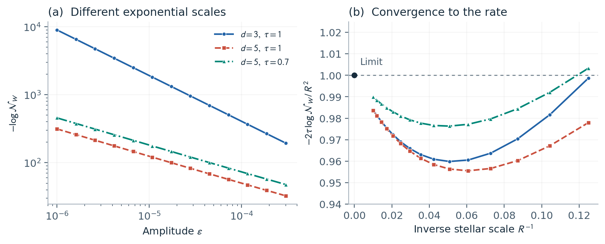
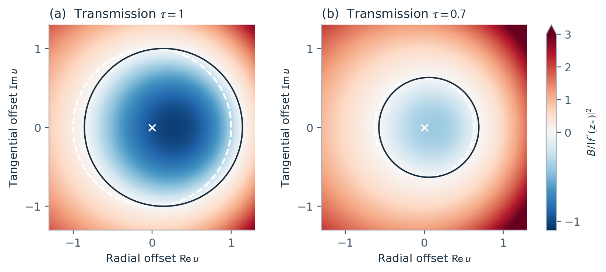

# Two scales of nonclassicality near coherent states

Javier Blanco-Romero

Department of Telematic Engineering, Universidad Carlos III de Madrid, Leganés, Madrid, Spain

Work in progress. Results and proofs remain under review.

Abstract {#abstract .unnumbered}
--------

Nudge a coherent state slightly toward the number states and ask how the change shows up. A field moment can respond linearly in the size of the nudge, while the negative part of the Wigner function is exponentially small. We compute both scales for a fixed finite superposition of displaced number states. The lowest occupied level sets the first moment that responds linearly, and the highest occupied level sets the logarithmic rate of the negative Wigner volume, including its dependence on optical loss. The negativity sits near zeros of the Bargmann polynomial, which drift into the Gaussian tail as the nudge shrinks. A moment criterion detects the same states at an algebraic order and keeps its sign under any nonzero transmission, even after the Wigner function has become nonnegative.

Introduction
------------

A coherent state is the most classical state of light, and its Wigner function, the quasiprobability distribution of the two field quadratures, is a positive Gaussian. Mix in a little of the number states and the state becomes nonclassical. How visible is that change? A field moment such as $\langle a^3\rangle$, with $a$ the annihilation operator, responds in proportion to the admixed amplitude $\epsilon$, because it measures interference between the coherent component and the admixture. The negative part of the Wigner function, the textbook signature of nonclassicality, can be far smaller, because it appears where the Gaussian envelope has almost died out.

The geometry of coherent states tells us how to organize the admixture \[[1](#ref-field1999geometry), [2](#ref-brody2010coherent)\]. Moving along the family of coherent states and taking successive derivatives generates the displaced number states, level by level. The level-zero state is the coherent state itself and level one is its tangent direction, so the genuinely new directions start at level two. For a fixed finite superposition of these normal directions, let $\nu$ be the lowest occupied level, $d$ the highest, and $c_n$ the amplitude of level $n$. We show that a moment of order $\nu$ responds linearly, $\langle a^\nu\rangle\propto\epsilon c_\nu$, while the negative Wigner volume $\mathcal N_W$ obeys

$$\log\mathcal N_W\simeq-\frac{(d!)^{1/d}}{2\tau|c_d|^{2/d}}\,\epsilon^{-2/d},$$

where $\tau>1/2$ is the intensity transmission of the optical loss. The reason is simple. The Bargmann polynomial, the wave function of the state in the coherent-state basis, is $1+\epsilon c_dz^d/\sqrt{d!}$ plus lower terms, and its zeros sit at $|z|\propto\epsilon^{-1/d}$. Negativity lives in small pockets around these zeros, so it pays the Gaussian envelope evaluated there. The two integers $\nu$ and $d$ coincide for a single occupied level, which hides the distinction.

The ingredients are known. Moment criteria and their homodyne sampling are standard \[[3](#ref-shchukin2005nonclassical), [4](#ref-richter1996correlation)\], zeros of the Husimi function constrain nonclassical depth \[[5](#ref-lutkenhaus1995)\] and define the stellar hierarchy \[[6](#ref-chabaud2020stellar)\], negative Wigner volume is a common diagnostic \[[7](#ref-kenfack2004negativity)\], and binary Fock superpositions appear in studies of complex Wigner entropy \[[8](#ref-cerf2024)\]. He finds a logarithmic Gaussian tail of the same kind for the noise that removes the negativity of a superposition of vacuum and three photons \[[9](#ref-he2026)\]. What we add is the general rate for any finite normal direction under pure loss, and its separation from the lowest moment response.

Section [2](#sec:normal) builds the normal directions, Sec. [3](#sec:theorem) states and proves the two scales, Sec. [4](#sec:moments) turns the first moment into a loss-resistant witness, and Sec. [5](#sec:numerics) checks the rate numerically.

Normal directions to the coherent curve {#sec:normal}
---------------------------------------

Let $a$ and $a^\dagger$ be the annihilation and creation operators of one optical mode, $[a,a^\dagger]=1$, with number states $|n\rangle$. The displacement operator $D(\alpha)=\exp(\alpha a^\dagger-\alpha^*a)$ creates the coherent state $|\alpha\rangle=D(\alpha)|0\rangle$. It is convenient to drop the normalization and use $|\widetilde\alpha\rangle=e^{\alpha a^\dagger}|0\rangle$, which depends holomorphically on $\alpha$. Differentiating this curve $p$ times produces nothing beyond the first $p$ displaced number states,

``{=html} $$\operatorname{span}\{\partial_\alpha^j|\widetilde\alpha\rangle:0\le j\le p\}
 =D(\alpha)\operatorname{span}\{|0\rangle,\ldots,|p\rangle\}.
 
\tag{1}$$

Indeed, $\partial_\alpha^j|\widetilde\alpha\rangle=(a^\dagger)^j|\widetilde\alpha\rangle$, and conjugation by $D(\alpha)$ turns $a^\dagger$ into $a^\dagger+\alpha^*$, so the two bases are related by a triangular matrix with nonzero diagonal. Level $0$ is the coherent ray, level $1$ is the tangent to the coherent curve, and the levels $n\ge2$ point in directions orthogonal to both. These are the normal directions.

Displacement shifts the Wigner function rigidly without changing its negative volume, so we sit at $\alpha=0$ and consider

``{=html} $$|\psi_\epsilon\rangle
 =\frac{|0\rangle+\epsilon\sum_{n=2}^d c_n|n\rangle}{\sqrt{Z_\epsilon}},
 \qquad Z_\epsilon=1+\epsilon^2\sum_{n=2}^d|c_n|^2,
 \qquad \nu=\min\{n:c_n\ne0\},
 
\tag{2}$$

with small $\epsilon>0$, fixed complex amplitudes $c_n$, and $c_d\ne0$. We call this a finite normal ray. All asymptotic statements below are for $\epsilon\downarrow0$ with $d$ and the $c_n$ held fixed.

Pure loss with intensity transmission $0\le\tau\le1$ is a beam splitter that mixes the mode with vacuum, $a_{\rm out}=\sqrt\tau\,a+\sqrt{1-\tau}\,v$, where $v$ annihilates the vacuum input. We write $\mathcal L_\tau$ for the resulting channel and $\rho_{\epsilon,\tau}=\mathcal L_\tau(|\psi_\epsilon\rangle\langle\psi_\epsilon|)$. Because $v$ annihilates the vacuum, every normally ordered moment is simply rescaled,

``{=html} $$\langle(a^\dagger)^r a^s\rangle_{\rm out}
 =\tau^{(r+s)/2}\langle(a^\dagger)^r a^s\rangle_{\rm in}.
 
\tag{3}$$

Loss also maps a coherent amplitude $\alpha$ to $\sqrt\tau\alpha$, so the reduction to $\alpha=0$ survives it.

Two asymptotic scales {#sec:theorem}
---------------------

We normalize the Wigner function so that the vacuum has $W_0(\beta)=2e^{-2|\beta|^2}/\pi$, with $\beta$ the complex phase-space coordinate, and measure nonclassicality by the negative volume

``{=html} $$\mathcal N_W(\rho)=\int_{\mathbb C}[-W_\rho(\beta)]_+\,d^2\beta,
 \qquad [x]_+=\max\{x,0\}.
 
\tag{4}$$

Since $W_\rho$ integrates to one, $\int|W_\rho|\,d^2\beta=1+2\mathcal N_W$.

**Theorem 1.** ``{=html} For the finite normal ray [(2)](#eq:ray), the expectation of every polynomial in $a,a^\dagger$ of total degree below $\nu$ has zero derivative in $\epsilon$ at $\epsilon=0$. For fixed $\tau>0$, the normalized moment of order $\nu$ satisfies

``{=html} $$\mathcal M_\nu(\rho_{\epsilon,\tau})
 :=\frac{\langle a^\nu\rangle_{\rho_{\epsilon,\tau}}}{\sqrt{\nu!}}
 =\tau^{\nu/2}\epsilon c_\nu+O(\epsilon^2).
 
\tag{5}$$

For every fixed $1/2<\tau\le1$,

``{=html} $$\lim_{\epsilon\downarrow0}\epsilon^{2/d}
 \log\mathcal N_W(\rho_{\epsilon,\tau})
 =-\frac{(d!)^{1/d}}{2\tau|c_d|^{2/d}}.
 
\tag{6}$$

For $0\le\tau\le1/2$ the Wigner function is nonnegative and $\mathcal N_W=0$.

The moment statement counts ladder operators, since a polynomial of degree below $\nu$ cannot connect the vacuum to an occupied level. The negativity statement comes from a balance between the constant term of the Bargmann polynomial and its highest power, which the next tool makes visible.

### The Wigner function as a polynomial kernel

Expanding a pure state in unnormalized coherent states, $|\psi\rangle=\sum_n\psi_n|n\rangle$ is represented by its Bargmann polynomial $f(z)=\sum_n\psi_nz^n/\sqrt{n!}$, which equals $\langle\widetilde{z^*}|\psi\rangle$. For our ray, up to normalization,

``{=html} $$f_\epsilon(z)=1+\epsilon\sum_{n=2}^d\frac{c_n z^n}{\sqrt{n!}} .
 
\tag{7}$$

Its zeros are the stellar zeros of the state. They are also the zeros of the Husimi function, and for $\epsilon>0$ there are $d$ of them, which places the state at stellar rank $d$ \[[6](#ref-chabaud2020stellar)\]. The Wigner function of the lossy state is a Gaussian times a positive combination of the derivatives of $f_\epsilon$, with weights set by the transmission \[[10](#ref-parisio2008)\]. Define the real kernel

``{=html} $$B_{\epsilon,\tau}(z)=\sum_{j=0}^d\frac{(1-2\tau)^j}{j!}
                  |f_\epsilon^{(j)}(z)|^2 .
 
\tag{8}$$

**Lemma 1.** ``{=html} The lossy state has Wigner function

``{=html} $$W_{\epsilon,\tau}(\beta)
 =\frac{2e^{-2|\beta|^2}}{\pi Z_\epsilon}
 B_{\epsilon,\tau}(2\sqrt\tau\,\beta^*).
 
\tag{9}$$

*Proof.* Coherent dyads $|\widetilde u\rangle\langle\widetilde v|$ generate all operators, and pure loss maps them to $e^{(1-\tau)uv^*}|\widetilde{\sqrt\tau u}\rangle\langle\widetilde{\sqrt\tau v}|$. The Wigner function of this image is

$$\frac2\pi e^{-2|\beta|^2}
 \exp\!\left[(1-2\tau)uv^*+
             2\sqrt\tau(\beta^*u+\beta v^*)\right].
\tag{10}$$

Expanding the term $(1-2\tau)uv^*$ in the exponential and matching the coefficients of $u^mv^{*n}$ with those of the state gives [(9)](#eq:kernel).

The sign of $B$ is the sign of $W$. For $\tau\le1/2$ every term in [(8)](#eq:B) is nonnegative, and at $\tau=1/2$ only $j=0$ survives, which is the Husimi function in disguise. Above one half the derivative terms come with alternating signs, and the kernel can turn negative near a zero of $f_\epsilon$, where the leading term vanishes and the $j=1$ term enters with the negative weight $1-2\tau$.

### Proof of theorem [1](#thm:scales) {#proof-of-theorem-thmscales}

*Moments.* Normal ordering does not raise the total degree, and a normally ordered monomial of degree below $\nu$ has no matrix element between the vacuum and an occupied level. This proves the first statement without loss, and [(3)](#eq:loss) carries it through loss. Explicitly,

``{=html} $$\langle a^k\rangle_{\psi_\epsilon}
 =\frac{1}{Z_\epsilon}\left[
 \epsilon\sqrt{k!}\,c_k+\epsilon^2
 \sum_{n=2}^{d-k}\sqrt{\frac{(n+k)!}{n!}}\,c_n^*c_{n+k}\right],
 
\tag{11}$$

with absent coefficients and empty sums set to zero. Taking $k=\nu$ gives [(5)](#eq:first).

*Where the zeros are.* The constant term of $f_\epsilon$ and its top term $\epsilon c_dz^d/\sqrt{d!}$ have equal size at the radius

``{=html} $$R=\left(\frac{\sqrt{d!}}{\epsilon|c_d|}\right)^{1/d},
 \qquad\text{and we set}\qquad q=2\tau-1>0.
 
\tag{12}$$

In the rescaled variable $w=z/R$, the lower powers are suppressed by powers of $R^{-1}$, so on compact sets

``{=html} $$f_\epsilon(Rw)=F(w)+O(R^{-1}),
 \qquad F(w)=1+e^{i\arg c_d}w^d,
 
\tag{13}$$

with the same estimate for all derivatives in $w$. The $d$ zeros $w_\ell$ of $F$ are simple and lie on the unit circle, so $f_\epsilon$ has zeros

``{=html} $$z_{\ell,\epsilon}=Rw_\ell+O(1),\qquad
 f_\epsilon'(z_{\ell,\epsilon})=R^{-1}F'(w_\ell)+O(R^{-2}),
 
\tag{14}$$

and its $j$th derivative is $O(R^{-j})$ in any fixed neighborhood of a zero.

*Negative pockets.* Near a zero, $f_\epsilon$ is linear to leading order and the higher derivatives are negligible, so Taylor expansion gives, uniformly for bounded $u$,

``{=html} $$\frac{B_{\epsilon,\tau}(z_{\ell,\epsilon}+u)}
 {|f_\epsilon'(z_{\ell,\epsilon})|^2}
 =|u|^2-q+O(R^{-1}).
 
\tag{15}$$

The kernel is therefore negative on the disk $|u|\le\sqrt q/2$ once $R$ is large, with $-B_{\epsilon,\tau}\ge CR^{-2}$ there. In the variable $z=2\sqrt\tau\beta^*$ the negative volume reads

``{=html} $$\mathcal N_W=\frac{1}{2\pi\tau Z_\epsilon}
 \int_{\mathbb C}[-B_{\epsilon,\tau}(z)]_+
             e^{-|z|^2/(2\tau)}\,d^2z,
 
\tag{16}$$

and integrating over one pocket, where $|z|^2=R^2+O(R)$, gives

``{=html} $$\log\mathcal N_W\ge-\frac{R^2}{2\tau}-O(R)-O(\log R).
 
\tag{17}$$

*No negativity closer in.* Choose $0<\delta<1$. On $|z|\le(1-\delta)R$ the limiting polynomial obeys $|F(z/R)|\ge1-(1-\delta)^d>0$, and [(13)](#eq:F) with its derivative estimates makes $B_{\epsilon,\tau}$ positive throughout this disk for large $R$. Outside it, the coefficients of $B_{\epsilon,\tau}$ stay bounded as $\epsilon\downarrow0$, so $|B_{\epsilon,\tau}|\le C(1+|z|^{2d})$, and the Gaussian in [(16)](#eq:integral) gives

``{=html} $$\log\mathcal N_W\le-\frac{(1-\delta)^2R^2}{2\tau}+O(\log R).
 
\tag{18}$$

Dividing both bounds by $R^2$, letting $\epsilon\downarrow0$ and then $\delta\downarrow0$, and using $\epsilon^{2/d}R^2=(d!)^{1/d}|c_d|^{-2/d}$ proves [(6)](#eq:rate). The case $\tau\le1/2$ follows from lemma [1](#lem:kernel).$\square$

In the physical phase plane, Eq. [(15)](#eq:pocket) gives each negative pocket a limiting radius and a receding center,

``{=html} $$r_{\rm pocket}=\frac{\sqrt{2\tau-1}}{2\sqrt\tau},
 \qquad |\beta_{\ell,\epsilon}|=\frac{R}{2\sqrt\tau}+O(1).
 
\tag{19}$$

The pockets keep a finite size while they drift into the tail. More loss shrinks them and pushes them farther out.

Moment detection under loss {#sec:moments}
---------------------------

A nonzero $\langle a^\nu\rangle$ does not by itself certify nonclassicality, since a mixture of coherent states can have one too. We need a criterion that every classical state obeys. Call a state classical if it is a positive mixture of coherent states $|\gamma\rangle$, and define the factorial moments $F_j=\langle(a^\dagger)^ja^j\rangle$ and

``{=html} $$\mathcal W_k=F_1F_{k-1}-|\langle a^k\rangle|^2,\qquad k\ge2.
 
\tag{20}$$

For a classical state the moments are averages of $|\gamma|^2$, $|\gamma|^{2(k-1)}$ and $\gamma^k$ over the mixture, and Cauchy-Schwarz applied to $\gamma^*$ and $\gamma^{k-1}$ gives $\mathcal W_k\ge0$. This is one of the moment inequalities of Ref. \[[3](#ref-shchukin2005nonclassical)\].

**Proposition 1.** For the ray [(2)](#eq:ray) and fixed $\tau>0$,

``{=html} $$\mathcal W_\nu(\rho_{\epsilon,\tau})
 =-\tau^\nu\nu!|c_\nu|^2\epsilon^2+O(\epsilon^3).
 
\tag{21}$$

The output is therefore nonclassical for all sufficiently small nonzero $\epsilon$, including when $\tau\le1/2$.

*Proof.* For $j\ge1$, $F_j=O(\epsilon^2)$ on the ray, so $F_1F_{\nu-1}=O(\epsilon^4)$, while Eq. [(5)](#eq:first) gives $|\langle a^\nu\rangle|^2=\tau^\nu\nu!|c_\nu|^2\epsilon^2+O(\epsilon^3)$. Loss acts by the exact identity $\mathcal W_k(\mathcal L_\tau\rho)=\tau^k\mathcal W_k(\rho)$, which follows from [(3)](#eq:loss).

For a single level, $(|0\rangle+\epsilon|k\rangle)/\sqrt{1+\epsilon^2}$, the witness is explicit,

``{=html} $$\mathcal W_k(\rho_{\epsilon,\tau})
 =\tau^k k!\,\frac{\epsilon^2(k\epsilon^2-1)}{(1+\epsilon^2)^2},
 
\tag{22}$$

and detects the state whenever $0<\epsilon^2<1/k$. Loss never flips the sign, but it does shrink the signal by $\tau^k$, so the number of measurements needed grows as $\tau$ decreases.

The responding moment can be measured with a homodyne detector, which records the rotated quadrature $q_\theta=(e^{-i\theta}a+e^{i\theta}a^\dagger)/\sqrt2$ at a chosen phase $\theta$ \[[4](#ref-richter1996correlation)\]. With the physicists\' Hermite polynomials $H_k$ and $h_k(q)=H_k(q)/\sqrt{2^k k!}$,

``{=html} $$\mathcal M_k=\int_0^{2\pi}\frac{d\theta}{2\pi}\,
 e^{ik\theta}\langle h_k(q_\theta)\rangle,
 
\tag{23}$$

because normal ordering of $H_k(q_\theta)$ and the phase average keep only the term $a^k$. With $M$ shots at uniformly random phases, the sample mean of $e^{ik\theta}h_k(q)$ is an unbiased estimator of $\mathcal M_k$ with complex mean-square error $1/M$ near vacuum. Correcting for a known loss multiplies this error by $\tau^{-k}$. Testing [(20)](#eq:witness) also requires the factorial moments and their uncertainties.

Examples and numerical checks {#sec:numerics}
-----------------------------

Two rays make the separation of scales concrete,

``{=html} $$|\psi_3\rangle=\frac{|0\rangle+\epsilon|3\rangle}{\sqrt{1+\epsilon^2}},
 \qquad
 |\psi_{3,5}\rangle=\frac{|0\rangle+\epsilon(|3\rangle+|5\rangle)}{\sqrt{1+2\epsilon^2}}.
 
\tag{24}$$

Both have $\nu=3$ and the same moment response $\mathcal M_3=\tau^{3/2}\epsilon+O(\epsilon^3)$, yet $-\log\mathcal N_W$ grows as $\epsilon^{-2/3}$ for the first and only as $\epsilon^{-2/5}$ for the second. Adding a little of $|5\rangle$ leaves the moment untouched and makes the negativity much larger. Figure [1](#fig:rates) shows both rates and checks Eq. [(6)](#eq:rate) through the scaled quantity $-2\tau\log\mathcal N_W/R^2$, whose limit is one. Figure [2](#fig:pockets) shows the local profile that produces the pockets.

{width="\\textwidth"}

**Figure 1.** Negative Wigner volume for the two rays in [(24)](#eq:examples). (a) The same linear moment response accompanies different growth rates of $-\log\mathcal N_W$ as $\epsilon$ decreases. (b) The scaled rates approach the limit one predicted by [(6)](#eq:rate); each point uses the amplitude that corresponds to its $R$ in [(12)](#eq:R). Symbols distinguish degree and transmission, and curves join numerical quadrature results.

``{=html}

{width="94%"}

**Figure 2.** Local Wigner kernel near a stellar zero of $|\psi_{3,5}\rangle$ at $R=14$. The plotted quantity is $B_{\epsilon,\tau}(z_*+e^{i\arg z_*}u)/|f_\epsilon'(z_*)|^2$, with $z_*$ a zero of smallest modulus, so the horizontal coordinate points radially outward in the $z$ plane. Both panels share one color scale. Solid curves mark the exact zero contour, and dashed circles have the radius $\sqrt{2\tau-1}$ predicted by [(15)](#eq:pocket). The Gaussian envelope is divided out to show the sign structure, so the colors are not Wigner densities.

``{=html}

The negative volumes lie far below floating-point underflow, so we evaluate [(16)](#eq:integral) around each separated stellar zero with logarithmic Gaussian weights, bisection for the sign boundary along angular rays, and Gauss-Legendre quadrature in angle and radius. The routine checks that the zeros are separated and samples for extra radial sign changes, so it applies only to isolated simple pockets. Refining from 64 radial and 192 angular nodes to 96 and 384 changes $\log\mathcal N_W$ by less than $10^{-7}$ on the plotted points. At $R=8$, an independent Cartesian integration agrees within $8\times10^{-4}$ in relative negative volume for three test directions, including complex coefficients. A separate density-matrix calculation applies the loss channel in the number basis and evaluates the Wigner function through associated Laguerre polynomials; it agrees with [(9)](#eq:kernel) to within $2\times10^{-12}$ for random states of degrees $3$, $5$ and $8$ at transmissions $0.1$, $0.5$, $0.7$ and $1$. These checks support the implementation, while the bounds [(17)](#eq:lower) and [(18)](#eq:upper) establish the result.

Scope
-----

Theorem [1](#thm:scales) holds coefficients, degree and transmission fixed, and its limit need not be uniform as $c_d\to0$, $d\to\infty$ or $\tau\downarrow1/2$. The power also depends on how the state approaches the coherent curve, and not only on its tangent. The normalized path proportional to

``{=html} $$|0\rangle+\epsilon|3\rangle+\epsilon^2|8\rangle
 
\tag{25}$$

leaves the coherent state in the same direction as $|\psi_3\rangle$. Its Bargmann polynomial, rescaled by $R=(8!)^{1/16}\epsilon^{-1/4}$, tends to $1+w^8$, because the cubic term is now $O(\epsilon^{1/4})$. The same proof gives

$$\lim_{\epsilon\downarrow0}\epsilon^{1/2}\log\mathcal N_W
 =-\frac{(8!)^{1/8}}{2\tau},\qquad \tau>1/2,
\tag{26}$$

set by the eighth level that the path reaches at second order.

For fixed finite normal rays the picture is clean. The first occupied level sets the lowest moment that responds linearly and its loss factor $\tau^{\nu/2}$. The last occupied level sets how far out the stellar zeros sit, and with it the exponential rate of the negative Wigner volume. A moment witness therefore sees the perturbation at order $\epsilon^2$ while the negative volume is smaller than any power of $\epsilon$.

Acknowledgments {#acknowledgments .unnumbered}
---------------

Part of the underlying geometric work was carried out during a research internship at the Department of Optics, Universidad Complutense de Madrid, in 2017 and 2018, supported by the Spanish Ministerio de Educación, Cultura y Deporte Collaboration Grant for the academic year 2017 to 2018.

Data availability {#data-availability .unnumbered}
-----------------

The accompanying code generates the figures and numerical data and runs the validation checks.

AI assistance {#ai-assistance .unnumbered}
-------------

AI tools assisted with the finite-ray extension, algebraic derivations, literature review, numerical code, and manuscript preparation. The checks of the formulas and numerical outputs are described in section [5](#sec:numerics) and supplied with the code. Some claims in this working paper remain to be independently checked.

References {#references .unnumbered}
----------

1.  ``{=html} Timothy R Field and Lane P Hughston. The geometry of coherent states. *Journal of Mathematical Physics*, 40(6):2568--2583, 1999.

2.  ``{=html} Dorje C Brody and Eva-Maria Graefe. Coherent states and rational surfaces. *Journal of Physics A: Mathematical and Theoretical*, 43(25):255205, 2010.

3.  ``{=html} Evgeny V. Shchukin and Werner Vogel. Nonclassical moments and their measurement. *Physical Review A*, 72(4):043808, 2005.

4.  ``{=html} Th. Richter. Determination of field correlation functions from measured quadrature component distributions. *Physical Review A*, 53(2):1197--1199, 1996.

5.  ``{=html} Norbert Lütkenhaus and Stephen M. Barnett. Nonclassical effects in phase space. *Physical Review A*, 51:3340--3342, 1995.

6.  ``{=html} Ulysse Chabaud, Damian Markham, and Frédéric Grosshans. Stellar representation of non-Gaussian quantum states. *Physical Review Letters*, 124(6):063605, 2020.

7.  ``{=html} Anatole Kenfack and Karol Życzkowski. Negativity of the Wigner function as an indicator of non-classicality. *Journal of Optics B: Quantum and Semiclassical Optics*, 6(10):396--404, 2004.

8.  ``{=html} Nicolas J. Cerf, Anaelle Hertz, and Zacharie Van Herstraeten. Complex-valued Wigner entropy of a quantum state. *Quantum Studies: Mathematics and Foundations*, 11:331--362, 2024.

9.  ``{=html} Zixuan He. Wigner entropy below vacuum: physical counterexamples and stability limits. [arXiv:2609.13312v2 \[quant-ph\]](https://arxiv.org/abs/2609.13312v2), 2026. Preprint, version 2, 24 September 2026.

10. ``{=html} Fernando Parisio. On Bargmann representations of Wigner function. *Journal of Physics A: Mathematical and Theoretical*, 41:055305, 2008.
