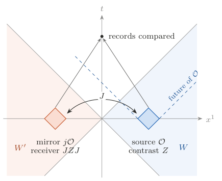
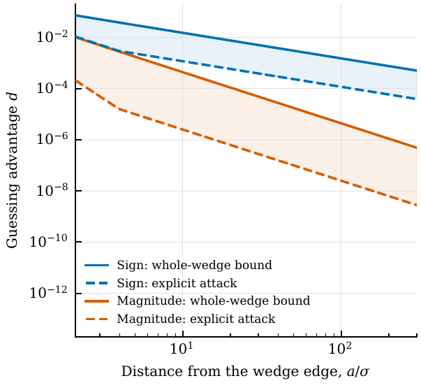

# Spacelike Guessing of Quantum Randomness

Javier Blanco-Romero and Florina Almenares Mendoza

Department of Telematic Engineering, Universidad Carlos III de Madrid, Leganés, Madrid, Spain

Work in progress. Results and proofs remain under review.

Abstract {#abstract .unnumbered}
--------

A quantum random number generator that measures the vacuum in a bounded region produces a bit that no spacelike observer can influence. A spacelike observer may still be able to guess it, because the vacuum is entangled across regions. We quantify this guessing for an observer confined to the opposite side of a Rindler wedge. A single number, the vacuum correlation between the measured observable and its mirror image through the wedge edge, controls the problem from both sides. An eavesdropper who repeats the source\'s measurement in the mirror region gains an advantage of half this correlation, and no measurement anywhere in the opposite wedge gains more than half its square root. The argument uses only Tomita-Takesaki theory and reduces to known discrimination bounds in finite dimensions. For a free scalar field the correlation depends on how the sampled field value is turned into a bit. A bit that records the sign of the field inherits its correlation with the mirror at first order, while a bit that records only whether the field is large inherits it at second order. For a compact massless source this improves the privacy guarantee from inverse distance to inverse distance squared, and a receiver whose size grows with the distance attains both rates.

Introduction {#sec:intro}
------------

A random number generator is secure only relative to a description of what the adversary holds. Security proofs for quantum random number generators model this side information as a quantum system correlated with the source \[[1](#ref-herrero2017quantum)\], and the conditional min-entropy turns it into a probability of guessing the output \[[2](#ref-koenig2009operational)\]. Relativity suggests a more concrete model, in which an adversary is a laboratory occupying a region of spacetime. If a bit is produced by measuring a quantum field in a bounded region, how well can someone confined to a spacelike separated region predict it?

Microcausality says she cannot influence the bit, and the source cannot signal her. Her records need not be independent of the bit, though, because the vacuum is entangled across spacelike regions \[[3](#ref-summers1987maximal), [4](#ref-reznik2003entanglement), [5](#ref-pozas2015harvesting)\], and conditioning on a local outcome changes the state assigned to spacelike observables \[[6](#ref-fewster2020quantum)\]. Earlier relativistic analyses of randomness generation studied how a detector exchanges information with a field \[[7](#ref-thinh2016certified), [8](#ref-lopp2018light)\]. We ask how much the field itself reveals to a spacelike region, and which measurement there reveals it.

For a source in the right Rindler wedge, the vacuum suggests where to look. It pairs every field mode in the wedge with a partner mode in the left wedge, its mirror image through the wedge edge, so an eavesdropper can repeat the source\'s measurement at the mirror point (Fig. [1](#fig:geometry)). Let $C$ be the vacuum correlation between the source\'s measured observable and its mirror copy, and let $d$ be the best guessing advantage available anywhere in the left wedge, the success probability of the best guess minus one half. We show that

$$\frac{C}{2}\ \le\ d\ \le\ \frac{\sqrt C}{2}.$$

The mirror attack achieves the left side, and no measurement in the left wedge exceeds the right side. The mirror is the modular conjugation of Tomita-Takesaki theory, an old acquaintance of algebraic field theory \[[9](#ref-araki1974some), [3](#ref-summers1987maximal), [10](#ref-guedes2024unruh), [11](#ref-caribe2026modular)\], and in finite dimensions the window reduces to known bounds on the pretty good measurement \[[12](#ref-hausladen1994pretty), [13](#ref-renes2017better)\]. Our proof needs no tensor-product description of the laboratories, and it turns the reflection into a privacy guarantee for a region of spacetime.

For a free scalar field, $C$ is the correlation between two copies of the readout, the rule that turns the sampled field value into a bit, applied to two weakly correlated Gaussian samples. A readout that keeps the sign of the field leaks at first order in their correlation, while one that asks only whether the field is large leaks at second order. For a compact massless source at distance $a$ from the wedge edge, this improves the guarantee from $a^{-1}$ to $a^{-2}$, and a detector that grows with the distance attains both powers.

Vacuum-noise random number generators digitize homodyne measurements of the electromagnetic vacuum, often by keeping the sign of a field quadrature \[[14](#ref-gabriel2010generator), [15](#ref-symul2011real)\], and the detectors of quantum key distribution also measure fields whose surroundings their security analyses usually leave out. Our setting is idealized, with a scalar field and an exact wedge, but it isolates the question these devices share, how much a region of spacetime learns from the field alone.

Section [2](#sec:setup) describes the bit and the eavesdropper, Sec. [3](#sec:overlap) proves the window above, and Sec. [4](#sec:geometry) places the mirror in spacetime. Section [5](#sec:free) computes the overlap for free fields and Sec. [6](#sec:distance) its decay with distance. We use units in which $\hbar$ and the speed of light equal one. The logarithm $\ln$ is natural; entropies of bits use $\log_2$.

A bit and a spacelike eavesdropper {#sec:setup}
----------------------------------

### Observables and laboratories

Quantum observables are operators on a Hilbert space $\mathcal H$. We write $B(\mathcal H)$ for the bounded operators on $\mathcal H$, $A^*$ for the adjoint of $A$, $\|A\|$ for the operator norm, and $\mathbf{1}$ for the identity. The operations available in one laboratory form an algebra, since sums, products, and adjoints of accessible operators are again accessible. Closing such an algebra under weak limits gives a von Neumann algebra, the standard mathematical model for the observables of a region in quantum field theory \[[16](#ref-haag1996local)\]. We write $\mathcal M\subseteq B(\mathcal H)$ for the algebra of the source\'s laboratory.

The field is in a state given by a unit vector $\Omega\in\mathcal H$, in our case the vacuum. For an operator $A\in B(\mathcal H)$, typically an observable of one of the laboratories,

$$\omega(A)=\langle\Omega,A\Omega\rangle$$

is its vacuum expectation value. Here $\langle\cdot,\cdot\rangle$ is the inner product of $\mathcal H$, so we apply $A$ to the vacuum and project the result back onto the vacuum. Two properties of the vacuum relative to a local algebra will be used throughout. $\Omega$ is cyclic for $\mathcal M$ if the vectors $A\Omega$ with $A\in\mathcal M$ are dense in $\mathcal H$, so that local operations on the vacuum can approximate any state. It is separating for $\mathcal M$ if $A\Omega=0$ with $A\in\mathcal M$ implies $A=0$, so that no nonzero local operator annihilates the vacuum. For the algebra of a region whose causal complement has nonempty interior, the Reeh-Schlieder theorem provides both \[[16](#ref-haag1996local)\]. They express vacuum entanglement. In finite dimensions, with $\mathcal M$ acting on one factor of a bipartite system, they say exactly that $\Omega$ has full Schmidt rank.

### The source

A two-outcome measurement assigns to each outcome $x\in\{+,-\}$ an effect $E_x$, an operator with $0\le E_x\le\mathbf{1}$ whose expectation $\omega(E_x)$ is the probability of that outcome. Effects are the standard description of a general quantum measurement, the elements of a positive operator-valued measure \[[17](#ref-helstrom1969quantum)\]. They include projective measurements, and they also describe detectors that are noisy or that respond only partially to the measured quantity. The effects add to the identity, $E_++E_-=\mathbf{1}$, because some outcome always occurs. The source\'s measurement happens in its laboratory, so $E_\pm\in\mathcal M$. Since one effect determines the other, a single operator describes the whole measurement,

``{=html} $$E_\pm=\tfrac12(\mathbf{1}\pm Z),\qquad Z=E_+-E_- .
 
\tag{1}$$

We call $Z$ the contrast of the measurement. The conditions $0\le E_\pm\le\mathbf{1}$ are equivalent to $Z=Z^*$ and $\|Z\|\le1$, and the correspondence is one to one. Every binary measurement has exactly one contrast, and every Hermitian $Z$ with $\|Z\|\le1$ defines a binary measurement through Eq. [(1)](#eq:effects). The contrast plays the role of the $\pm1$ observable that the device reads. Its expectation $\omega(Z)=\omega(E_+)-\omega(E_-)$ is the bias of the bit, and for a sharp measurement $Z$ is literally an observable with eigenvalues $\pm1$, like a spin component. A random number generator should produce a fair bit, with both outcomes equally likely in the vacuum, so we require

``{=html} $$\omega(Z)=0 .
 
\tag{2}$$

The second moment $q=\omega(Z^2)\in[0,1]$ says how much of the randomness comes from the field. If the measurement is sharp, meaning that $E_\pm$ are projections, then $Z^2=\mathbf{1}$ and $q=1$, and the field alone decides the outcome. At the other extreme, $Z=0$ gives $E_\pm=\tfrac12\mathbf{1}$. These effects do not depend on the field at all, so each outcome has probability one half whatever the field does. Every bit must take its randomness from somewhere, and here it can only come from a separate system inside the device, an internal coin, which is why such a device needs a trusted ancilla. The bit is perfectly private against any field observer, but it is no longer a quantum field random number generator, and its security rests entirely on the coin. Intermediate cases interpolate. A device that performs a sharp field measurement with contrast $Z_{\rm s}$ with probability $t$, and otherwise flips its coin, has $Z=tZ_{\rm s}$ and $q=t^2$. We assume $Z\ne0$, so $q>0$.

### The eavesdropper

The eavesdropper, whom we also call the receiver, works in a laboratory spacelike separated from the source. Microcausality, also called Einstein causality, is the axiom of relativistic quantum field theory that observables localized at spacelike separation commute. It is how the theory forbids faster-than-light influence, since measuring one of two commuting observables cannot change the statistics of the other, as we check below. Every observable of the receiver therefore commutes with every observable of the source. The commutant

$$\mathcal M'=\{B\in B(\mathcal H):AB=BA\ \text{for all}\ A\in\mathcal M\}$$

collects all such operators, so the receiver\'s algebra $\mathcal N$ satisfies $\mathcal N\subseteq\mathcal M'$. The commutant is the largest algebra that any observer can hold while commuting with the source, and a bound for $\mathcal M'$ covers every spacelike laboratory at once.

Commutation is what makes the joint statistics simple. Suppose the receiver performs a two-outcome measurement with effects $F_\pm\in\mathcal N$. Measuring the field also disturbs it, and a general measurement by the source is described by Kraus operators $L_{xa}\in\mathcal M$. Outcome $x$ leaves the field in the unnormalized state $L_{xa}\Omega$, where $a$ labels details of the apparatus that are not recorded, and $\sum_aL_{xa}^*L_{xa}=E_x$ ensures that the outcome probabilities are $\omega(E_x)$. The probability that the source obtains $x$ and the receiver obtains $y$ is

``{=html} $$P(x,y)=\sum_a\omega(L_{xa}^*F_yL_{xa})=\omega(E_xF_y),
 
\tag{3}$$

where the second equality moves $F_y$ through $L_{xa}$, which commute because one lies in $\mathcal M$ and the other in $\mathcal M'$. The details of the source\'s apparatus drop out and only its effects matter. Summing over the source outcome gives $P(y)=\omega(F_y)$, the probability the receiver would find if the source had done nothing at all. This is the absence of signaling, since nothing the source does changes the receiver\'s own statistics. Correlations, however, survive in $P(x,y)$.

### Guessing the bit

The receiver guesses $x$ when her outcome is $x$. Any guessing strategy ends with a guess, and grouping outcomes according to the guess they produce reduces it to such a two-outcome measurement. Her success probability is $\sum_x\omega(E_xF_x)$. Writing her effects as $F_\pm=\tfrac12(\mathbf{1}\pm B)$, with her own contrast $B=F_+-F_-$, a Hermitian operator in $\mathcal N$ with $\|B\|\le1$, the success probability becomes

``{=html} $$\sum_x\omega(E_xF_x)=\tfrac12\bigl[1+\omega(ZB)\bigr].
 
\tag{4}$$

Everything depends on the correlation $\omega(ZB)$ between the two contrasts. The best receiver in $\mathcal N$ guesses with probability $P_{\rm guess}(X|\mathcal N)=\tfrac12+d(X|\mathcal N)$, where

``{=html} $$d(X|\mathcal N)=\tfrac12\sup\bigl\{\omega(ZB):\ B=B^*\in\mathcal N,\ \|B\|\le1\bigr\}
 
\tag{5}$$

is the guessing advantage. It is the standard measure of privacy. It equals the trace distance between the actual joint state of the bit and the receiver\'s algebra and an ideal state in which the bit is uniform and independent of the receiver, and it fixes the conditional min-entropy \[[2](#ref-koenig2009operational), [18](#ref-berta2016smooth)\],

$$\begin{aligned}
 H_{\min}(X|\mathcal N)&=-\log_2P_{\rm guess}(X|\mathcal N)\\
 &=1-\log_2\bigl[1+2d(X|\mathcal N)\bigr].
 \end{aligned}$$

These identities hold for von Neumann algebras exactly as for matrices \[[17](#ref-helstrom1969quantum), [2](#ref-koenig2009operational)\]. We say the bit is $\varepsilon$-private against $\mathcal N$ when $d(X|\mathcal N)\le\varepsilon$.

The mirror receiver {#sec:overlap}
-------------------

### A finite-dimensional warm-up

Which receiver contrast $B$ correlates best with $Z$? Consider first a finite-dimensional pair in the entangled state $\Omega=\sum_i\sqrt{p_i}\,|i\rangle|i\rangle$, where the source acts on the first factor and the receiver on the second. The source\'s reduced state is $\rho=\sum_ip_i|i\rangle\langle i|$, with all $p_i>0$ so that $\Omega$ is cyclic and separating. If the state is maximally entangled, all $p_i$ equal, then $(Z\otimes\mathbf{1})\Omega=(\mathbf{1}\otimes Z^{\mathsf T})\Omega$, where $\mathsf T$ is the transpose in the basis $\{|i\rangle\}$. A receiver who measures $Z^{\mathsf T}$ on her half then reproduces a sharp source outcome exactly. For unequal $p_i$ the correlation is imperfect, but the transposed measurement remains the natural candidate. Field theory needs the same idea without any tensor-product splitting, because the algebras of complementary regions do not factorize. Tomita-Takesaki theory provides it.

### Tomita-Takesaki theory in brief

Because $\Omega$ is separating, each vector $A\Omega$ comes from a unique $A\in\mathcal M$, so the antilinear Tomita map

$$S:\ A\Omega\mapsto A^*\Omega,\qquad A\in\mathcal M,$$

is well defined. It compares the excitation created by $A$ with the one created by its adjoint. It is closable, and the closure has a polar decomposition $S=J\Delta^{1/2}$ \[[19](#ref-witten2018aps)\]. The modular conjugation $J$ is antiunitary, with $J^2=\mathbf{1}$ and $J\Omega=\Omega$, and the central theorem of the theory states $J\mathcal MJ=\mathcal M'$. Conjugation by $J$ thus maps every source observable to an observable of the commutant. This is the mirror. The modular operator $\Delta$ is positive with trivial kernel, and $K=-\ln\Delta$ is the modular Hamiltonian. The vacuum is a thermal state for the local algebra with respect to the dynamics generated by $K$, in the precise sense of the Kubo-Martin-Schwinger condition, and $\Delta=e^{-K}$ plays the role of its Boltzmann factor \[[19](#ref-witten2018aps)\]. In the finite-dimensional warm-up, $J$ exchanges the two factors while complex conjugating in the basis $\{|i\rangle\}$, so that $J(Z\otimes\mathbf{1})J=\mathbf{1}\otimes Z^{\mathsf T}$, and $\Delta=\rho\otimes\rho^{-1}$.

Applied to a vector $A\Omega$, the definition of $S$ gives the identity we use repeatedly,

``{=html} $$\Delta^{1/2}A\Omega=JA^*\Omega,\qquad A\in\mathcal M.
 
\tag{6}$$

### The modular overlap

The mirror receiver measures the reflected contrast $JZJ$. It is Hermitian, has norm at most one, and lies in $\mathcal M'$, so it is an admissible receiver contrast. By Eq. [(4)](#eq:success) its success is governed by

``{=html} $$\begin{aligned}
 C_Z&=\omega(Z\,JZJ)=\langle Z\Omega,JZ\Omega\rangle\\
 &=\langle Z\Omega,\Delta^{1/2}Z\Omega\rangle=\|\Delta^{1/4}Z\Omega\|^2 ,
 \end{aligned}
 
\tag{7}$$

where we used $J\Omega=\Omega$, $Z=Z^*$, and Eq. [(6)](#eq:half). We call $C_Z$ the modular overlap; it is the quantity $C$ of the introduction. It is the vacuum correlation between the source contrast and its mirror, or equivalently the overlap between the excitation $Z\Omega$ that the source\'s observable creates and its reflection $JZ\Omega$. The Cauchy-Schwarz inequality gives $C_Z\le\|Z\Omega\|^2=q$, and $C_Z>0$ because $\Omega$ is separating and $\Delta^{1/4}$ has trivial kernel.

The last form of Eq. [(7)](#eq:overlap) has a thermal reading. Let $\mu_Z$ be the probability distribution of the modular energy $k$ in the normalized excitation $Z\Omega/\sqrt q$, that is, the spectral measure of $K$ in that vector. Since $\Delta^{1/2}=e^{-K/2}$,

``{=html} $$C_Z=q\int e^{-k/2}\,d\mu_Z(k).
 
\tag{8}$$

The mirror sees the source\'s excitation through the square root of the vacuum\'s Boltzmann factor. Components of large positive modular energy are exponentially suppressed. The spectrum of $K$ has both signs, so Eq. [(8)](#eq:boltzmann) needs the full distribution, and Appendix [A](#sec:cost) shows what is lost when only its mean is kept.

**Theorem 1 (Modular overlap).** ``{=html} Let $Z$ be a fair contrast in $\mathcal M$, as in Eqs. [(1)](#eq:effects) and [(2)](#eq:fair).

1.  The mirror receiver, with effects $\tfrac12(\mathbf{1}\pm JZJ)\in\mathcal M'$, guesses the source outcome with probability $\tfrac12(1+C_Z)$.

2.  Every receiver $\mathcal N\subseteq\mathcal M'$ obeys $d(X|\mathcal N)\le\tfrac12\sqrt{C_Z}$.

Consequently,

``{=html} $$C_Z\ \le\ 2\,d(X|\mathcal M')\ \le\ \sqrt{C_Z} .
 
\tag{9}$$

*Proof.* Part (a) is Eq. [(4)](#eq:success) with $B=JZJ$, together with Eq. [(7)](#eq:overlap).

For part (b) it suffices to take $\mathcal N=\mathcal M'$, the largest receiver. The key observation is that every receiver contrast is itself a mirror. If $B\in\mathcal M'$ is Hermitian with $\|B\|\le1$, then $A=JBJ$ is a Hermitian contraction in $\mathcal M$ and $B=JAJ$. Repeating the computation of Eq. [(7)](#eq:overlap) with $A$ in place of the second $Z$, and then applying the Cauchy-Schwarz inequality,

$$|\omega(ZB)|=|\langle Z\Omega,\Delta^{1/2}A\Omega\rangle|
 \le\|\Delta^{1/4}Z\Omega\|\,\|\Delta^{1/4}A\Omega\| .
\tag{10}$$

The first factor is $\sqrt{C_Z}$. The second satisfies $\|\Delta^{1/4}A\Omega\|^2=\langle A\Omega,JA\Omega\rangle\le\|A\Omega\|^2\le1$, by Eq. [(6)](#eq:half), Cauchy-Schwarz, and antiunitarity of $J$. Hence $\omega(ZB)\le\sqrt{C_Z}$ for every admissible $B$, and Eq. [(5)](#eq:privacy) gives the claim.

The proof shows where both ends of the window come from. Whatever the receiver measures, it is the mirror of some source observable $A$, and her advantage is a modular inner product between $Z$ and $A$. Choosing $A=Z$ gives the attack. Cauchy-Schwarz bounds every other choice by the geometric mean of the two self-overlaps, and the self-overlap of $A$ is at most one. In practice, $C_Z\le4\varepsilon^2$ certifies $\varepsilon$-privacy against the whole commutant, while $C_Z>2\varepsilon$ rules it out against a receiver able to measure $JZJ$. In entropic terms,

``{=html} $$1-\log_2(1+\sqrt{C_Z})\le H_{\min}(X|\mathcal M')
 \le1-\log_2(1+C_Z).
 
\tag{11}$$

These bounds concern the receiver\'s field observables. Side information outside the field algebra, such as a purification of the source\'s measurement apparatus, defines a different access model.

Back in the finite-dimensional warm-up, Eq. [(7)](#eq:overlap) becomes

``{=html} $$C_Z=\operatorname{Tr}(\sqrt\rho\,Z\sqrt\rho\,Z),\qquad
 2d(X|\mathcal M')=\|\sqrt\rho\,Z\sqrt\rho\|_1,
 
\tag{12}$$

with $\|\cdot\|_1$ the trace norm. After the source obtains outcome $\pm$, the receiver\'s half is left in the unnormalized state $\tau_\pm=\operatorname{Tr}_1[(E_\pm\otimes\mathbf{1})|\Omega\rangle\langle\Omega|]=(\sqrt\rho E_\pm\sqrt\rho)^{\mathsf T}$, where $\operatorname{Tr}_1$ traces out the source\'s factor; its trace is the probability of the outcome. To tell such states apart, a standard choice is the pretty good measurement \[[12](#ref-hausladen1994pretty), [20](#ref-barnum2002reversing)\]. With $\tau=\tau_++\tau_-$, it has effects $F_\pm=\tau^{-1/2}\tau_\pm\tau^{-1/2}$, which weight each state by its share of the total and are known to be close to optimal. Here $\tau=\rho^{\mathsf T}$, and the formula gives $F_\pm=E_\pm^{\mathsf T}$, which is the mirror receiver. If $P_{\rm PGM}=(1+C_Z)/2$ and $P_{\rm opt}$ are the success probabilities of this measurement and of the optimal one, Renes\'s bound $P_{\rm PGM}\ge P_{\rm opt}^2+(1-P_{\rm opt})^2$ \[[13](#ref-renes2017better)\] is exactly the upper inequality in Eq. [(9)](#eq:window). Both ends of the window are attained. For a qubit with $\rho=\operatorname{diag}(p,1-p)$, $p=(1+e^{-b})^{-1}$ for a parameter $b\ge0$, and the Pauli contrast $Z=\sigma_x$, Eq. [(12)](#eq:matrix) gives $2d=C_Z=\operatorname{sech}(b/2)$, so the mirror is optimal. For $\rho=\mathbf{1}/2$ and the unsharp contrast $Z=t\sigma_z$ with $0<t\le1$, it gives $2d=t=\sqrt{C_Z}$, so the square root is sharp.

The mirror in spacetime {#sec:geometry}
-----------------------

We now identify the abstract mirror with a spacelike laboratory. The Rindler wedge is the natural place to do this, for two reasons. Physically, its complement models an eavesdropper who controls everything on the far side of a plane through the source\'s neighborhood. Mathematically, it is the region whose modular objects are known in closed form for every Wightman field theory. In $3+1$ dimensions write a spacetime point as $x=(t,x^1,\bm x_\perp)$, with $\bm x_\perp$ the transverse coordinates. The right wedge $W=\{x:x^1>|t|\}$ is the region that a family of uniformly accelerated observers can see and influence, and its causal complement is the left wedge $W'=\{x:x^1<-|t|\}$. Take $\mathcal M=\mathcal A(W)$, the algebra of observables localized in $W$. In the theories we consider, wedge duality $\mathcal A(W)'=\mathcal A(W')$ holds, so the commutant is exactly the algebra of the left wedge.

Bisognano and Wichmann identified the modular objects of the wedge geometrically \[[21](#ref-bisognano1975duality), [22](#ref-bisognano1976duality)\]. The modular Hamiltonian is $K=2\pi\mathcal B$, where $\mathcal B=\int_{t=0}x^1T_{00}\,d^3x$ is the generator of the boosts that preserve $W$, integrated over the whole spatial slice, and $T_{00}$ is the energy density. The thermal property of the vacuum therefore becomes the Unruh effect, in which accelerated observers, whose clock is the boost, see a thermal bath. The modular conjugation implements the reflection

``{=html} $$j(t,x^1,\bm x_\perp)=(-t,-x^1,\bm x_\perp),\qquad J\mathcal A(\mathcal O)J=\mathcal A(j\mathcal O),
 
\tag{13}$$

for any region $\mathcal O$, combined with charge conjugation in theories with charges. For a neutral scalar field $\Phi$ smeared with a real test function $f$, $J\Phi(f)J=\Phi(f\circ j)$. The partner of a right-wedge observable is the same observable at the reflected point.

**Figure 1.** A source measures a bit in a bounded region $\mathcal O$ inside the wedge $W$. The modular conjugation $J$ maps its contrast $Z$ to an observable of the reflected region $j\mathcal O\subset W'$, which lies outside the causal future of $\mathcal O$. No signal connects the two laboratories, yet their records, compared later in a common future, are correlated with strength $C_Z$.

``{=html}

If the source\'s contrast lies in the algebra $\mathcal A(\mathcal O)$ of a bounded region $\mathcal O\subset W$, the mirror contrast lies in $\mathcal A(j\mathcal O)$. The attack therefore needs only a reflected laboratory of the same size as the source, while the upper bound of Theorem [1](#thm:main) covers every observable in the left wedge. A different wedge containing $\mathcal O$ gives a different mirror and a different access region, so bounds are meaningful only once the adversary\'s region is fixed. We use $W$ throughout.

Free fields {#sec:free}
-----------

### From the field to a bit

Let $\Phi$ be a free neutral scalar field of any mass in its vacuum. A detector does not measure the field at a point. It samples a weighted average $\Phi(f)=\int\Phi(x)f(x)\,d^4x$, where $f$ is a smooth real weight function that vanishes outside a bounded part of the source region. We write $f\in C_c^\infty(W)$, the space of infinitely differentiable functions whose support is compact and contained in $W$. In the vacuum $\Phi(f)$ is a centered Gaussian random variable. The mirror receiver samples $\Phi(f\circ j)$, the same average over the reflected region. Two numbers describe the pair,

``{=html} $$\begin{aligned}
 v&=\omega\bigl(\Phi(f)^2\bigr)=\|h\|^2,\\
 c&=\omega\bigl(\Phi(f)\Phi(f\circ j)\bigr)=\langle h,\delta^{1/2}h\rangle ,
\end{aligned}
 
\tag{14}$$

the vacuum variance of the sampled field and its covariance with the mirror sample. Here $h=\Phi(f)\Omega$ is the one-particle vector created by the smeared field, assumed nonzero, and $\delta$ is the modular operator restricted to the one-particle space \[[23](#ref-eckmann1973application)\]; the second form of $c$ is Eq. [(6)](#eq:half) at the one-particle level. Their ratio

$$\rho=c/v\in(0,1)$$

is the vacuum correlation coefficient between the source sample and the mirror sample. It is positive by the argument that gave $C_Z>0$, and it is strictly below one because $\rho=1$ would require a nonzero boost-invariant one-particle vector, which the scalar field does not have.

The detector turns the sampled value into a bit. We describe this by a readout function $F$ with $|F|\le1$. When the sampled value is $\phi$, the source reports $+$ with probability $\tfrac12[1+F(\phi)]$. A sharp readout takes only the values $\pm1$; the sign, $F=\operatorname{sgn}$, is the familiar example. A readout with $|F|<1$ adds internal randomness to the field value. The contrast is $Z=F(\Phi(f))$. Writing $\xi$ for a centered Gaussian variable of variance $v$, which has the vacuum distribution of $\Phi(f)$, fairness reads $\mathbb EF(\xi)=0$ and the contrast variance is $q=\mathbb EF(\xi)^2$.

### The overlap is a Gaussian correlation

The spacelike samples $\Phi(f)$ and $\Phi(f\circ j)$ commute, so they have a joint vacuum distribution, and it is Gaussian with variances $v$ and covariance $c$. The mirror receiver applies the same readout to her sample. The modular overlap is therefore the correlation between two copies of the readout,

``{=html} $$C_Z=\omega\bigl(F(\Phi(f))\,F(\Phi(f\circ j))\bigr)=\mathbb E\bigl[F(\xi)F(\eta)\bigr],
 
\tag{15}$$

where $(\xi,\eta)$ is a centered Gaussian pair with variances $v$ and covariance $c$. The question is now elementary. Two weakly correlated Gaussian variables pass through the same function, and we ask how correlated the outputs remain.

The natural way to answer is to decompose the readout into pieces of definite polynomial degree. The normalized probabilists\' Hermite polynomials $\mathrm{He}_n/\sqrt{n!}$ are orthonormal for the Gaussian weight. The first ones are $\mathrm{He}_1(u)=u$, which is sensitive to the sign of the field, and $\mathrm{He}_2(u)=u^2-1$, which responds to its magnitude. Expanding the readout,

``{=html} $$a_n=\frac{\mathbb E\bigl[F(\xi)\,\mathrm{He}_n(\xi/\sqrt v)\bigr]}{\sqrt{n!}},\qquad a_0=0 ,
 
\tag{16}$$

where $a_0=\mathbb EF(\xi)$ vanishes by fairness. An odd readout has only odd coefficients and an even readout only even ones. Mehler\'s identity says that the Hermite pieces of $\xi$ and $\eta$ are correlated only degree by degree, each with its own power of $\rho$,

$$\mathbb E\left[\frac{\mathrm{He}_n(\xi/\sqrt v)}{\sqrt{n!}}\,
          \frac{\mathrm{He}_m(\eta/\sqrt v)}{\sqrt{m!}}\right]
 =\delta_{nm}\rho^n ,$$

with $\delta_{nm}$ the Kronecker delta. A degree-$n$ feature of the field is correlated with its mirror counterpart as the $n$th power of the field correlation.

**Proposition 2 (Free-field overlap).** ``{=html} With these definitions,

``{=html} $$C_Z=\sum_{n\ge1}a_n^2\rho^n .
 
\tag{17}$$

Moreover $q=\sum_na_n^2$, so $C_Z\le q\rho$ and every receiver in $W'$ obeys

``{=html} $$d\bigl(X|\mathcal A(W')\bigr)\le\tfrac12\sqrt{q\rho} .
 
\tag{18}$$

*Proof.* Expand $F(\xi)$ and $F(\eta)$ in the orthonormal Hermite basis and use Mehler\'s identity in Eq. [(15)](#eq:gaussian) \[[24](#ref-janson1997gaussian)\]. The expansions converge in Gaussian $L^2$, and Cauchy-Schwarz justifies exchanging sum and expectation. Parseval\'s identity gives $q=\sum_n a_n^2$. Since $a_0=0$ and $0<\rho<1$, every term obeys $a_n^2\rho^n\le a_n^2\rho$, so $C_Z\le q\rho$, and Theorem [1](#thm:main) gives the bound.

At large separation $\rho$ is small, so the lowest Hermite degree present in the readout dominates the leak. This is the design principle behind the next subsection.

### Choosing the readout

The most common digitizer records the sign of the field, $Z=\operatorname{sgn}\Phi(f)$, the scalar analogue of vacuum homodyne generators that digitize the sign of a field quadrature \[[14](#ref-gabriel2010generator), [15](#ref-symul2011real)\]. It is sharp, so $q=1$, and Sheppard\'s arcsine law \[[25](#ref-sheppard1899application)\], the classical formula for the probability that two correlated Gaussian variables have the same sign, gives

``{=html} $$C_Z=\frac2\pi\arcsin\rho .
 
\tag{19}$$

The sign is an odd function with $a_1\ne0$, so it leaks at first order in $\rho$. The eavesdropper\'s sample is slightly more likely to share the sign of the source\'s sample, and the sign is exactly what the bit records.

To do better, the readout should avoid the low Hermite degrees. Let $r=\min\{n\ge1:a_n\ne0\}$ be the Hermite rank of the readout. Since $C_Z\le q\rho^r$,

``{=html} $$C_Z=a_r^2\rho^r+O(\rho^{r+1}),\qquad
 d(X|\mathcal A(W'))\le\tfrac12\sqrt q\,\rho^{r/2}.
 
\tag{20}$$

Raising the rank suppresses leakage to every receiver in the left wedge. An even readout, which ignores the sign of the field, has rank at least two. A small linear correlation barely changes how large either sample tends to be, so the magnitudes of the two samples are correlated only at order $\rho^2$. A sharp and fair choice asks whether the field is large. Let $\Phi_{\rm G}$ and $\phi_{\rm G}$ be the standard normal distribution function and density, and set $z_0=\Phi_{\rm G}^{-1}(3/4)$, so that $|\xi|>z_0\sqrt v$ with probability exactly one half. The readout

``{=html} $$F(\xi)=2\,\mathbf1_{\{|\xi|>z_0\sqrt v\}}-1,
 
\tag{21}$$

with $\mathbf 1$ the indicator of the event, reports $+$ for a large field and $-$ for a small one. Its first nonzero coefficient is $a_2=2\sqrt2\,z_0\phi_{\rm G}(z_0)$, obtained by integrating $(u^2-1)\phi_{\rm G}(u)$ over the two tails. The mirror advantage is now $O(\rho^2)$, and the whole-wedge advantage is at most $\rho/2$ for every $\rho$, and $\tfrac12a_2\rho\simeq0.30\,\rho$ as $\rho\to0$. Both the sign and the magnitude readouts produce a sharp fair bit drawn entirely from the field, with $q=1$. Only the feature of the field being recorded has changed.

Sharp thresholds are idealized measurements. A physical alternative is a Ramsey probe, a qubit prepared in the $+1$ eigenstate $|{+}x\rangle$ of its Pauli operator $\sigma_x$, coupled to the field through the unitary $\exp[-\tfrac i2\sigma_z\otimes\Phi(f)]$, and read out in the $\sigma_y$ basis, with trusted preparation and control. Because the free-field commutator is a c-number, time ordering of this coupling, smeared over spacetime, only contributes a phase, and the probe induces exactly the field effects $\tfrac12[\mathbf{1}\pm\sin\Phi(f)]$. Proposition [2](#prop:free) with $F=\sin$ gives

``{=html} $$C_Z=e^{-v}\sinh(\rho v),\qquad q=\tfrac12(1-e^{-2v}).
 
\tag{22}$$

The sine is odd, so the Ramsey readout has rank one and leaks at first order, like the sign. Reading the same probe in the $\sigma_x$ basis gives the effects $\tfrac12[\mathbf{1}\pm\cos\Phi(f)]$ instead. The cosine is even, and its vacuum mean $m=e^{-v/2}$ is removed if the device turns each $+$ into $-$ with probability $m/(1+m)$. The probe then realizes exactly the fair rank-two readout of Eq. [(32)](#eq:even-smooth), which has finite modular energy (Appendix [A](#sec:cost)).

### A receiver solved exactly

How good is the mirror attack compared with the best receiver? The full left-wedge algebra is hard to optimize over, but the mirror sample alone gives an exactly solvable class. Let $\mathcal N_f$ be the algebra generated by $\Phi(f\circ j)$. Its contrasts are functions $G(\eta)$ of the single Gaussian variable $\eta$, with advantage $\tfrac12\mathbb E[F(\xi)G(\eta)]=\tfrac12\mathbb E\{\mathbb E[F(\xi)|\eta]\,G(\eta)\}$. The best choice follows the sign of the conditional mean, $G=\operatorname{sgn}\mathbb E[F(\xi)|\eta]$, and

``{=html} $$2d(X|\mathcal N_f)=\mathbb E\bigl|\mathbb E[F(\xi)|\eta]\bigr|.
 
\tag{23}$$

For the sign readout the optimal contrast is $\operatorname{sgn}\eta$, the mirror itself, and $d(X|\mathcal N_f)=\pi^{-1}\arcsin\rho=C_Z/2$. For the magnitude readout, Mehler\'s identity gives $\mathbb E[F(\xi)|\eta]=a_2\rho^2(u^2-1)/\sqrt2+O(\rho^4)$ with $u=\eta/\sqrt v$, so the best such receiver thresholds $|\eta|$ at $\sqrt v$ and gains $4z_0\phi_{\rm G}(z_0)\phi_{\rm G}(1)\rho^2\simeq0.207\,\rho^2$ to leading order, slightly more than the mirror\'s $C_Z/2\simeq0.184\,\rho^2$ and of the same order. For the Ramsey readout,

``{=html} $$\mathbb E[\sin\xi|\eta]=e^{-v(1-\rho^2)/2}\sin(\rho\eta),
 
\tag{24}$$

so the optimal contrast is $\operatorname{sgn}\sin(\rho\eta)$, which beats the modular mirror $\sin\eta$. Weaken the coupling by rescaling $f\mapsto\lambda f$ at fixed geometry, with $v$ the variance before rescaling. As $\lambda\to0$ the optimal advantage is $\lambda\rho\sqrt{2v/\pi}/2+o(\lambda)$, linear in $\lambda$ like the upper bound $\sqrt{C_Z}/2=\lambda\sqrt{\rho v}/2+o(\lambda)$, whereas the mirror advantage $C_Z/2$ is quadratic in $\lambda$. Weakly coupled field readouts thus realize the square-root scaling of Theorem [1](#thm:main).

{width="\\columnwidth"}

**Figure 2.** Privacy bounds for the compact source of Eq. [(25)](#eq:profile) and two sharp fair readouts. Each solid curve is the whole-wedge upper bound $\sqrt{C_Z}/2$, and each dashed curve is an explicit attack, the better of the mirror receiver and the growing receiver of Sec. [6](#sec:distance). The shaded bands contain the optimal guessing advantages. Attack and bound fall with the same asymptotic power of $a$, and the constants between them are open. The magnitude upper bound lies below the sign attack.

``{=html}

How fast the leak decays {#sec:distance}
------------------------

To see the size of these effects, take a massless field and a source of size $\sigma$, symmetric in time and centered at distance $a$ from the wedge edge. We use a smooth bump that vanishes outside a ball, so that the source lives strictly inside the wedge and all integrals converge,

``{=html} $$f(t,\bm x)=\lambda\,b(t/\sigma)\,B\bigl(|\bm x-a\bm e_1|/\sigma\bigr),
 
\tag{25}$$

with amplitude $\lambda$, unit vector $\bm e_1$ along $x^1$, and smooth bumps $b(s)=B(s)=e^{-1/(1-s^2)}$ for $|s|<1$ and zero otherwise. The support lies inside $W$ when $a>2\sigma$. The mirror weight $f\circ j$ is the same bump centered at $-a\bm e_1$, a distance $2a$ from the source. Far apart, the two samples are correlated through the massless vacuum two-point function at spacelike separation $2a$, which equals $(16\pi^2a^2)^{-1}$, so

``{=html} $$\rho=\frac{1}{16\pi^2a^2v}\Bigl(\int f\,d^4x\Bigr)^2\bigl[1+O(\sigma^2/a^2)\bigr] .
 
\tag{26}$$

For these bumps $\rho\simeq0.145\,(\sigma/a)^2$, and the leading term is accurate to about $0.2\%$ at $a=10\sigma$. Appendix [B](#app:profile) reduces $v$, $c$, and the modular energy to one-dimensional integrals.

Feeding $\rho\propto a^{-2}$ into Eq. [(20)](#eq:rank) gives the upper curves of Fig. [2](#fig:leakage). The whole-wedge bound falls as $a^{-1}$ for the sign readout and as $a^{-2}$ for the magnitude readout, and the mirror attack as $a^{-2}$ and $a^{-4}$. At large distance a better eavesdropper exists. A massless field has no length scale, so a receiver whose weight is the source bump dilated in space and time by $a/\sigma$, centered about $3a$ behind the wedge edge and normalized as in Appendix [B](#app:profile), sees fluctuations of fixed size, while its correlation with the source falls only as $\gamma\propto a^{-1}$ (Appendix [B](#app:profile)). Applying the source\'s readout to this sample gives advantages of order $a^{-1}$ for the sign and $a^{-2}$ for the magnitude, the same powers as the upper bounds. The optimal constants, and the decay for receivers of fixed size, remain open. Throughout the plotted range the magnitude bound also lies strictly below the sign mirror attack (Appendix [B](#app:profile)), so there the magnitude bit is provably better hidden.

The weight function offers a second handle. The leading terms of the massless two-point function at orders $a^{-2}$ and $a^{-3}$ both carry the factor $\int f\,d^4x$, so a weight with zero integral has $\rho=O(a^{-4})$, and the decay is faster still if further moments vanish.

At $a=10\sigma$, $\rho\simeq1.45\times10^{-3}$. The exact overlap then bounds the whole-wedge advantage by about $0.0152$ for the sign readout and $4.41\times10^{-4}$ for the balanced magnitude readout. These numbers refer to the compact profile, with distances in units of its size. A detector realization would further specify the coupling and the readout resolution.

Conclusion {#sec:discussion}
----------

The privacy of a vacuum-generated bit depends on the spacetime region available to the adversary and on the feature of the field that the readout records. The modular overlap captures both. It measures an explicit attack from the mirror region and, through its square root, bounds every receiver in the opposite wedge. For a free scalar field the overlap is a Gaussian correlation, and the lowest Hermite degree present in the readout sets how fast the bound falls with distance, so a readout that ignores the sign of the field is protected at second order. The readout is part of the privacy design.

These are single-round guarantees for the specified access region. For the compact massless source a receiver that grows with the distance attains the decay of the whole-wedge bound, but the optimal constants and the case of receivers of fixed size remain open. Extracting a private string \[[26](#ref-tomamichel2011leftover), [18](#ref-berta2016smooth)\] requires a min-entropy bound for blocks of bits, since successive measurements can be correlated with each other and with the same receiver. Multi-round bounds and finite-resource detector models are the next steps toward a field-theoretic security analysis of a random number generator.

Acknowledgments {#acknowledgments .unnumbered}
---------------

The Spanish Government supported this work through the DISCOVERY project, grant PID2023-148716OB-C33, funded by MICIU/AEI/10.13039/501100011033 ("DIstributed Smart Communications with Verifiable EneRgy-optimal Yields"). The Community of Madrid provided further support through the RAMONES-CM project (TEC-2024/COM-504), awarded by Order 5696/2024 of the General Directorate of Research and Technological Innovation.

Data availability {#data-availability .unnumbered}
-----------------

The accompanying code specifies the numerical source profiles, generates the figure data, and runs the numerical checks.

Modular energy and sharp readouts {#sec:cost}
---------------------------------

Equation [(8)](#eq:boltzmann) depends on a full spectral distribution. Replacing that distribution by its mean gives a simpler lower bound on leakage, connecting spacelike guessing with modular bounds on local state preparation \[[27](#ref-blanco2026modular)\]. Comparing this bound with the exact overlap shows which information the mean discards. Write $\psi_Z=Z\Omega/\sqrt q$ for the normalized excitation, whose spectral measure for $K$ is $\mu_Z$. Equation [(6)](#eq:half) fixes a normalization,

``{=html} $$\int e^{-k}\,d\mu_Z(k)=\|\Delta^{1/2}\psi_Z\|^2=\frac{\|JZ\Omega\|^2}{q}=1 .
 
\tag{27}$$

Since $\max(-k,0)\le e^{-k}$, the negative part of $k$ is integrable, and the mean modular energy

``{=html} $$\kappa_Z=\int k\,d\mu_Z(k)\in[0,\infty]
 
\tag{28}$$

is always defined. Jensen\'s inequality applied to Eq. [(27)](#eq:balance) gives $\kappa_Z\ge0$.

**Proposition 3 (Entropic cost).** ``{=html} The overlap obeys $C_Z\ge q\,e^{-\kappa_Z/2}$. If the measurement is sharp, $Z^2=\mathbf{1}$, then

``{=html} $$\kappa_Z=S(\omega_Z\|\omega),\qquad \omega_Z(A)=\omega(ZAZ),\quad A\in\mathcal M,
 
\tag{29}$$

where $S$ is Araki\'s relative entropy on $\mathcal M$ \[[28](#ref-araki1975relative)\].

*Proof.* Jensen\'s inequality for the convex function $e^{-k/2}$ gives $C_Z/q=\int e^{-k/2}d\mu_Z\ge e^{-\kappa_Z/2}$. If $Z^2=\mathbf{1}$, then $Z$ is a unitary in $\mathcal M$, and the vector $Z\Omega$ represents $\omega_Z$ on $\mathcal M$ and $\omega$ on $\mathcal M'$. The relative Tomita operator $AZ\Omega\mapsto A^*\Omega$ equals $ZS$ on the dense set $\mathcal MZ\Omega=\mathcal M\Omega$, so the relative modular operator is $(ZS)^*(ZS)=S^*Z^*ZS=S^*S=\Delta$, using $Z^*Z=\mathbf{1}$. Araki\'s definition $S(\omega_Z\|\omega)=-\langle Z\Omega,\ln\Delta_{\Omega,Z\Omega}\,Z\Omega\rangle$ then reduces to $\langle Z\Omega,KZ\Omega\rangle=\kappa_Z$.

For a sharp measurement the contrast is a unitary flip, and $\kappa_Z$ is its relative entropy on the source algebra. For the Lüders instrument, each normalized branch $(\Omega\pm Z\Omega)/\sqrt2$ has mean modular energy $\kappa_Z/2$, since $K\Omega=0$. This is an expectation of the modular Hamiltonian, not a general lower bound on laboratory work.

**Corollary 4 (Entropic converse).** ``{=html} For a sharp fair bit and any receiver containing $JZJ$,

``{=html} $$d(X|\mathcal N)\ \ge\ \tfrac12\,e^{-S(\omega_Z\|\omega)/2} .
 
\tag{30}$$

Privacy error $\varepsilon<\tfrac12$ against such a receiver requires $S(\omega_Z\|\omega)\ge2\ln[1/(2\varepsilon)]$.

The factor $1/2$ in the exponent cannot be improved. In the two-level example of Sec. [3](#sec:overlap), $\kappa_Z=b\tanh(b/2)$ and $C_Z\sim2e^{-\kappa_Z/2}$ as $b\to\infty$, so no bound $C_Z\ge c\,e^{-a\kappa_Z}$ with fixed $c>0$ holds for $a<\tfrac12$. The bound can nevertheless be very loose. Jensen\'s inequality retains only the mean, while the exponential in Eq. [(8)](#eq:boltzmann) weights the lower part of the modular spectrum more strongly. For unsharp readouts the prefactor $q$ also matters, since reducing the field dependence can lower the leakage without raising the modular energy.

### Energy of a Gaussian readout

In the free-field Fock representation, $\Delta=\Gamma(\delta)$ and $K=d\Gamma(k)$ with $k=-\ln\delta$ \[[23](#ref-eckmann1973application)\], where $\Gamma(\delta)$ acts as $\delta^{\otimes n}$ on the $n$-particle sector, and $d\Gamma(k)$ sums $k$ over the particles in that sector. Thus the modular Hamiltonian is a sum of one-particle generators. Smooth compact support of $f$ makes $S_f=\langle h,kh\rangle$ finite, and the mean modular energy factorizes as

``{=html} $$\kappa_Z=\frac{S_f}{v}\,\bar n,\qquad \bar n=\frac1q\sum_{n\ge1}n\,a_n^2 .
 
\tag{31}$$

Here $S_f>0$ is the vacuum relative entropy on $\mathcal A(W)$ of the coherent state $e^{i\Phi(f)}\Omega$, and $\bar n$ is the mean Hermite order of the readout, which is its mean particle number in the Fock expansion below. If $F$ is weakly differentiable with $F'(\xi)$ square integrable, then $\bar n=v\,\mathbb E[F'(\xi)^2]/q$; otherwise $\bar n=\infty$. Jensen\'s inequality for $n\mapsto\rho^n$ gives $C_Z\ge q\rho^{\bar n}\ge q\,e^{-\kappa_Z/2}$.

To see the factorization, set $\hat h=h/\sqrt v$ and $e_n=(n!)^{-1/2}a^\dagger(\hat h)^n\Omega$. Here $a^\dagger(\hat h)$ creates a particle in the normalized mode $\hat h$, so $e_n$ is the corresponding normalized $n$-particle state. Wick ordering gives $Z\Omega=\sum_n a_n e_n$, and

$$\langle e_n,d\Gamma(k)e_n\rangle
 =n\langle\hat h,k\hat h\rangle ,$$

with no cross terms between particle sectors. The negative part of $K$ is integrable in $Z\Omega$ by Eq. [(27)](#eq:balance), so summing the sector expectations proves Eq. [(31)](#eq:factor) even when the positive part diverges. The Weyl unitary $U=e^{i\Phi(f)}\in\mathcal A(W)$ creates a coherent state with one-particle amplitude $ih$. For a local unitary $U$ the relative Tomita operator is $US$, as in Proposition [3](#prop:cost), so its relative entropy is $\langle U\Omega,KU\Omega\rangle=\langle ih,k\,ih\rangle=S_f$ \[[29](#ref-longo2019entropy), [30](#ref-casini2019relative)\]. Jensen gives $c/v\ge e^{-S_f/(2v)}$, and $S_f=0$ would force $c/v=1$, which was excluded in Sec. [5](#sec:free). The identity $\sum_n na_n^2=v\,\mathbb E[F'(\xi)^2]$ follows from $\mathrm{He}_n'=n\,\mathrm{He}_{n-1}$, and finiteness is equivalent to the weak-derivative condition \[[31](#ref-nualart2006malliavin)\]. Geometrically, $S_f$ is $2\pi$ times the boost energy of the classical wave generated by $f$ \[[29](#ref-longo2019entropy), [32](#ref-ciolli2020information)\]. For $F=\sin$, Eq. [(31)](#eq:factor) gives $\kappa_Z=S_f\coth v$.

Sharp readouts have infinite modular energy. The sign function has no weak derivative in Gaussian $L^2$, so $\bar n=\infty$ and $\kappa_Z=\infty$. The same holds for every nonconstant sharp readout of one smeared field, including Eq. [(21)](#eq:magnitude). If $F^2=1$ had a square-integrable weak derivative, differentiating $F^2$ would give $F'=0$ and force $F$ to be constant. The entropic converse of Corollary [4](#cor:converse) is then silent, yet the sign readout still leaks at least $\rho/\pi$ to the mirror. The overlap remains informative even when the energy bound vanishes. A smooth readout can also achieve Hermite rank two at finite modular energy. With $m=e^{-v/2}$, the smooth even readout

``{=html} $$F(\xi)=\frac{\cos\xi-m}{1+m},\qquad
 C_Z=\frac{m^2[\cosh(\rho v)-1]}{(1+m)^2},
 
\tag{32}$$

is fair, bounded by one, and has a square-integrable derivative, so its modular energy is finite; its covariance follows from the Gaussian characteristic function. The Ramsey probe read in the $\sigma_x$ basis realizes it (Sec. [5](#sec:free)).

For the compact profile [(25)](#eq:profile), $S_f=2\pi a\langle\omega\rangle v$ with $\langle\omega\rangle\simeq1.60/\sigma$ (Appendix [B](#app:profile)). At $a=10\sigma$ the one-particle Jensen bound $e^{-S_f/(2v)}$ is of order $10^{-22}$, while $\rho\simeq1.5\times10^{-3}$. The mean modular energy grows linearly with distance, making its exponential lower bound very small. That bound allows the much larger algebraic overlap and does not determine its decay. The spectral average retains information that the mean discards, which is why the main result uses the overlap itself.

Profile integrals {#app:profile}
-----------------

Let $a(\bm k)$ and $a^\dagger(\bm k)$ annihilate and create momentum modes, respectively. With $[a(\bm k),a^\dagger(\bm k')]=(2\pi)^32|\bm k|\,\delta^3(\bm k-\bm k')$, where $\delta^3$ is the three-dimensional Dirac delta, the one-particle wave function of $\Phi(f)\Omega$ is the restriction of the Fourier transform $\tilde f(k^0,\bm k)=\int d^4x\,f(x)e^{i(k^0t-\bm k\cdot\bm x)}$ to the mass shell $k^0=|\bm k|$. For the profile [(25)](#eq:profile) it equals $g(k)e^{-ik^1a}$, with $k=|\bm k|$ and $g(k)=\lambda\sigma^4\hat b(k\sigma)\hat B(k\sigma)$. Here $\hat b$ is the one-dimensional Fourier transform and $\hat B$ the three-dimensional radial transform of the dimensionless bumps; both are real. The reflected profile has wave function $g(k)e^{ik^1a}$. Angular integration with the measure $d^3k/[(2\pi)^32k]$ gives

$$v=\frac{1}{4\pi^2}\int_0^\infty kg^2\,dk,\qquad
 c=\frac{1}{4\pi^2}\int_0^\infty kg^2\,\frac{\sin2ka}{2ka}\,dk .
\tag{33}$$

For large $a$ the second integral tends to $g(0)^2/(16\pi^2a^2)$ with $g(0)=\int f\,d^4x$, which is Eq. [(26)](#eq:rhoasym). The boost generator acts on one-particle wave functions as $i|\bm k|\,\partial_{k^1}$, and the term containing $g'$ is odd in $k^1$ and integrates to zero, so

$$S_f=2\pi\langle h,\mathcal Bh\rangle=2\pi a\,v\,\langle\omega\rangle,\qquad
 \langle\omega\rangle=\frac{\int_0^\infty k^2g^2\,dk}{\int_0^\infty kg^2\,dk},
\tag{34}$$

which is $2\pi$ times the energy of the wave packet weighted by the position $x^1=a$ of its center.

##### A growing receiver. {#a-growing-receiver. .unnumbered}

Set $\sigma=1$ and $\lambda>0$, and let $f_0$ be the profile [(25)](#eq:profile) centered at the origin, so that the source weight is $f(x)=f_0(x-ae)$ with $e$ the unit vector along $x^1$. The receiver samples $\Phi(f_{\rm R})$ with

$$f_{\rm R}(y)=a^{-3}f_0(y/a+3e),
\tag{35}$$

the source bump stretched by $a$ in space and time and centered at $-3ae$. Its support obeys $|t|\le a$ and $x^1\le-2a<-|t|$, so it lies in $W'$ for every $a>0$, and bounded functions of $\Phi(f_{\rm R})$ belong to $\mathcal A(W')$. The massless two-point distribution $\mathcal W(x-y)=\omega(\Phi(x)\Phi(y))$ is homogeneous, $\mathcal W(az)=a^{-2}\mathcal W(z)$. Rescaling both integration variables by $a$ produces $a^8$ from the measures, $a^{-6}$ from the two prefactors, and $a^{-2}$ from $\mathcal W$, so the receiver\'s variance equals $v$ for every $a$. Rescaling only the receiver variable, $y=a(s-3e)$, gives the covariance with the source,

$$c_{\rm R}=\frac1a\int d^4u\,d^4s\,f_0(u)f_0(s)\,\mathcal W\Bigl(4e-s+\frac ua\Bigr).
\tag{36}$$

On the supports, $4e-s$ has spatial length at least $3$ and time component at most $1$, so the argument is spacelike and $\mathcal W(z)=[4\pi^2(|\bm z|^2-(z^0)^2)]^{-1}$ is smooth and positive there. Expanding in $u/a$, the linear term vanishes because $f_0$ is centered, and

$$\begin{aligned}
 \gamma&=\frac{c_{\rm R}}{v}=\frac\kappa a+O(a^{-3}),\\
 \kappa&=\frac1v\int f_0\,d^4u\int f_0(s)\,\mathcal W(4e-s)\,d^4s>0 .
\end{aligned}
\tag{37}$$

The receiver applies the source\'s readout to its sample and reports the outcome as its guess. The pair is Gaussian with correlation $\gamma$, so by Eq. [(17)](#eq:mehler) with $\rho$ replaced by $\gamma$ its advantage is $\frac12\sum_na_n^2\gamma^n$. A readout of Hermite rank $r$ thus gains $\frac12a_r^2\kappa^ra^{-r}$ to leading order, the same power as the upper bound $\frac12\sqrt q\,\rho^{r/2}$. Numerically $\kappa\simeq0.0370$, so the sign advantage behaves as $0.0118/a$ and the magnitude advantage as $2.5\times10^{-4}/a^2$. In momentum space $c_{\rm R}=(16\pi^2a)^{-1}\int_0^\infty g(k/a)g(k)\sin4k\,dk$, which is how the figure evaluates it.

##### Magnitude against sign. {#magnitude-against-sign. .unnumbered}

The magnitude readout has only even Hermite coefficients, so Parseval bounds its overlap by $C_Z\le w\rho^2+(1-w)\rho^4$, with $w=a_2^2\simeq0.368$. The sign mirror attack obeys $2\pi^{-1}\arcsin\rho\ge2\rho/\pi$, whose square exceeds this bound whenever $\rho^2<(4/\pi^2-w)/(1-w)$, that is for $\rho<0.244$. Hence $\frac12\sqrt{C_Z}<\pi^{-1}\arcsin\rho$ throughout the plotted range $\rho<0.035$.

##### Numerics. {#numerics. .unnumbered}

For Fig. [2](#fig:leakage), the transforms are evaluated by quadrature, and the oscillatory integral uses sine-weighted quadrature of an interpolated $g^2$. Doubling the momentum grid gives the same displayed coefficients. For the magnitude readout, integration by parts gives $a_n=4\phi_{\rm G}(z_0)\mathrm{He}_{n-1}(z_0)/\sqrt{n!}$ for even $n\ge2$, with all odd coefficients zero. We sum through $n=20$; Parseval bounds the omitted overlap by $\rho^{22}$, below $5.1\times10^{-33}$ over the plotted range. The plotted upper bound includes this remainder, and direct Gaussian quadrature checks the series. The scripts record the profile, quadrature settings, and figure data. Numerical checks of Theorem [1](#thm:main), Proposition [3](#prop:cost), and Proposition [2](#prop:free), including a finite-dimensional test of the window [(9)](#eq:window) on random states and a truncated two-mode model of the free-field formulas, are provided with the accompanying code.

AI assistance {#ai-assistance .unnumbered}
-------------

AI tools assisted with writing, mathematical derivations, literature review, and numerical code. Some claims in this working paper remain to be independently checked.

References {#references .unnumbered}
----------

1.  ``{=html} Miguel Herrero-Collantes and Juan Carlos Garcia-Escartin. Quantum random number generators. *Rev. Mod. Phys.*, 89(1):015004, 2017.

2.  ``{=html} Robert König, Renato Renner, and Christian Schaffner. The operational meaning of min- and max-entropy. *IEEE Trans. Inf. Theory*, 55(9):4337--4347, 2009.

3.  ``{=html} Stephen J. Summers and Reinhard Werner. Maximal violation of Bell\'s inequalities is generic in quantum field theory. *Commun. Math. Phys.*, 110(2):247--259, 1987.

4.  ``{=html} Benni Reznik. Entanglement from the vacuum. *Found. Phys.*, 33(1):167--176, 2003.

5.  ``{=html} Alejandro Pozas-Kerstjens and Eduardo Martı́n-Martı́nez. Harvesting correlations from the quantum vacuum. *Phys. Rev. D*, 92(6):064042, 2015.

6.  ``{=html} Christopher J. Fewster and Rainer Verch. Quantum fields and local measurements. *Commun. Math. Phys.*, 378(2):851--889, 2020.

7.  ``{=html} Le Phuc Thinh, Jean-Daniel Bancal, and Eduardo Martı́n-Martı́nez. Certified randomness from a two-level system in a relativistic quantum field. *Phys. Rev. A*, 94(2):022321, 2016.

8.  ``{=html} Richard Lopp and Eduardo Martı́n-Martı́nez. Light, matter, and quantum randomness generation: A relativistic quantum information perspective. *Opt. Commun.*, 423:29--47, 2018.

9.  ``{=html} Huzihiro Araki. Some properties of modular conjugation operator of von Neumann algebras and a non-commutative Radon-Nikodym theorem with a chain rule. *Pac. J. Math.*, 50(2):309--354, 1974.

10. ``{=html} F. M. Guedes, M. S. Guimaraes, I. Roditi, and S. P. Sorella. Unruh-De Witt detectors, Bell-CHSH inequality and Tomita-Takesaki theory. *J. High Energy Phys.*, 2024(6):31, 2024.

11. ``{=html} J. G. A. Caribé, M. S. Guimaraes, I. Roditi, and S. P. Sorella. Modular theory and the Bell-CHSH inequality in relativistic scalar quantum field theory. *Eur. Phys. J. C*, 86(7):823, 2026.

12. ``{=html} Paul Hausladen and William K. Wootters. A 'pretty good' measurement for distinguishing quantum states. *J. Mod. Opt.*, 41(12):2385--2390, 1994.

13. ``{=html} Joseph M. Renes. Better bounds on optimal measurement and entanglement recovery, with applications to uncertainty and monogamy relations. *Phys. Rev. A*, 96(4):042328, 2017.

14. ``{=html} Christian Gabriel, Christoffer Wittmann, Denis Sych, Ruifang Dong, Wolfgang Mauerer, Ulrik L. Andersen, Christoph Marquardt, and Gerd Leuchs. A generator for unique quantum random numbers based on vacuum states. *Nat. Photonics*, 4(10):711--715, 2010.

15. ``{=html} Thomas Symul, Syed M. Assad, and Ping Koy Lam. Real time demonstration of high bitrate quantum random number generation with coherent laser light. *Appl. Phys. Lett.*, 98(23):231103, 2011.

16. ``{=html} Rudolf Haag. *Local Quantum Physics*. Springer, Berlin, 2nd edition, 1996.

17. ``{=html} Carl W. Helstrom. Quantum detection and estimation theory. *J. Stat. Phys.*, 1(2):231--252, 1969.

18. ``{=html} Mario Berta, Fabian Furrer, and Volkher B. Scholz. The smooth entropy formalism for von Neumann algebras. *J. Math. Phys.*, 57(1):015213, 2016.

19. ``{=html} Edward Witten. APS medal for exceptional achievement in research: Invited article on entanglement properties of quantum field theory. *Rev. Mod. Phys.*, 90(4):045003, 2018.

20. ``{=html} Howard Barnum and Emanuel Knill. Reversing quantum dynamics with near-optimal quantum and classical fidelity. *J. Math. Phys.*, 43(5):2097--2106, 2002.

21. ``{=html} Joseph J. Bisognano and Eyvind H. Wichmann. On the duality condition for a Hermitian scalar field. *J. Math. Phys.*, 16(4):985--1007, 1975.

22. ``{=html} Joseph J. Bisognano and Eyvind H. Wichmann. On the duality condition for quantum fields. *J. Math. Phys.*, 17(3):303--321, 1976.

23. ``{=html} Jean-Pierre Eckmann and Konrad Osterwalder. An application of Tomita\'s theory of modular Hilbert algebras: Duality for free Bose fields. *J. Funct. Anal.*, 13(1):1--12, 1973.

24. ``{=html} Svante Janson. *Gaussian Hilbert Spaces*. Cambridge University Press, Cambridge, 1997.

25. ``{=html} W. F. Sheppard. On the application of the theory of error to cases of normal distribution and normal correlation. *Philos. Trans. R. Soc. London A*, 192:101--167, 1899.

26. ``{=html} Marco Tomamichel, Christian Schaffner, Adam Smith, and Renato Renner. Leftover hashing against quantum side information. *IEEE Trans. Inf. Theory*, 57(8):5524--5535, 2011.

27. ``{=html} Javier Blanco-Romero and Florina Almenares Mendoza. Modular lower bounds on Reeh-Schlieder state preparation, 2026.

28. ``{=html} Huzihiro Araki. Relative entropy of states of von Neumann algebras. *Publ. Res. Inst. Math. Sci.*, 11(3):809--833, 1975.

29. ``{=html} Roberto Longo. Entropy of coherent excitations. *Lett. Math. Phys.*, 109(12):2587--2600, 2019.

30. ``{=html} Horacio Casini, Sergio Grillo, and Diego Pontello. Relative entropy for coherent states from Araki formula. *Phys. Rev. D*, 99(12):125020, 2019.

31. ``{=html} David Nualart. *The Malliavin Calculus and Related Topics*. Probability and Its Applications. Springer, Berlin, 2nd edition, 2006.

32. ``{=html} Fabio Ciolli, Roberto Longo, and Giuseppe Ruzzi. The information in a wave. *Commun. Math. Phys.*, 379(3):979--1000, 2020.
